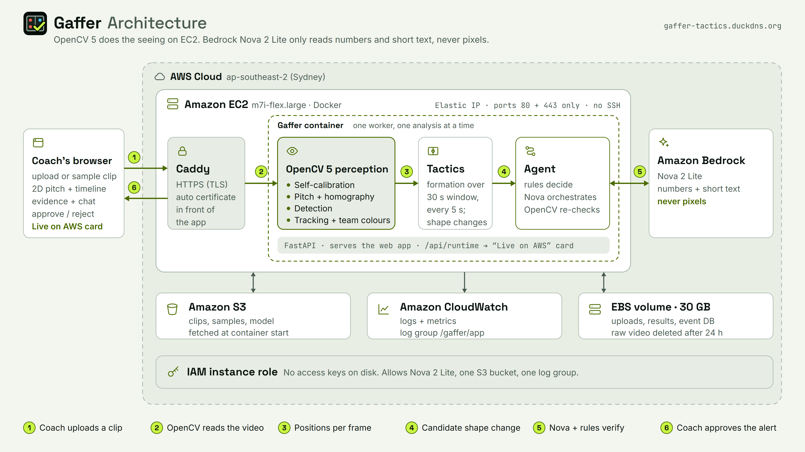
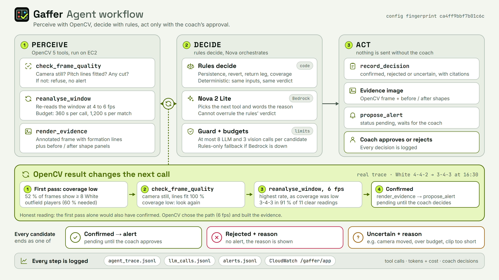

<p align="center"></p>

# Gaffer

**Broadcast-level tactical analysis costs clubs thousands. Gaffer gives any coach a tactical analyst that watches the match, spots the moment the opponent changes shape, and checks its own eyes before it speaks.**

Built for the **OpenCV AI Competition 2026, powered by AWS**. OpenCV 5.0.0 (`opencv-contrib-python==5.0.0.93`) does the vision work, an Amazon Bedrock agent (Nova 2 Lite) decides what to look at next, and the coach approves every alert.

**Live app: https://gaffer-tactics.duckdns.org/** (fallback, plain http: http://13.210.196.109/). If neither opens, see the demo video (link: TBD-VIDEO).
Judges: [`docs/TECHNICAL_REPORT.md`](docs/TECHNICAL_REPORT.md) · [Agentic Vision Award evidence](docs/TECHNICAL_REPORT.md#agentic-vision-award-evidence) · [`docs/DEVPOST.md`](docs/DEVPOST.md) · [`docs/DEMO_SCRIPT.md`](docs/DEMO_SCRIPT.md)

## What Gaffer does in 30 seconds

1. **Watches** a match video (top-down drone or a high fixed camera, whole pitch visible) with OpenCV 5: finds the players, tracks them, tells the teams apart by shirt colour, and maps every position onto a 2D pitch.
2. **Reads each team's formation** every few seconds and flags the moment a team **switches shape** (for example White 4-4-2 → 3-4-3 at 16:30).
3. **Checks its own eyes.** Every flagged change is a *candidate*. The agent sends OpenCV back to look again (is the camera still, is the pitch fitted, does the new shape hold when the window is re-read at a higher rate?). If the second look does not support it, the candidate is rejected or marked uncertain, with the reason.
4. **Asks the coach.** A confirmed change becomes an alert with a picture of the evidence. The coach approves or rejects it. Nothing is sent without that.

## Try it

| What | How |
|---|---|
| **Live analysis (recorded TeamTrack match)** | Open `/app`, choose *Live analysis*. It replays 6 minutes of a real amateur match (15:00 to 21:00) with the video beside a 2D pitch; the dots, shapes, the 16:30 change and the agent's check appear as the clock reaches them. It is a recorded replay, not a live camera. |
| **Upload sample 1: "The demo match" (TeamTrack)** | *Upload your own video → Try this clip.* 30 s, 1080p, 32 MB. "The demo match, where shape changes can be found." (30 s is too short for the shape change itself; the full 6 minutes are in *Live analysis*.) |
| **Upload sample 2: "New ground (Zenodo)"** | 30 s, 1080p (21 MB) copy of a clip from a different pitch (artificial turf, low sun, long shadows). "An unseen ground: shows players and teams on a pitch Gaffer was never tuned on. 30 s is too short for a shape change." |
| **Your own clip** | Each sample has a plain **Download** link if you want to test with the file. See "What footage works". |
| **Ask the analyst** | Open the chat on the result page; answers are grounded in the stored results and say "I can't answer that" otherwise. |

### What footage works

**Best:** 4K or 1080p top-down drone or high fixed camera with the whole pitch visible. **720p works but is less tested:** on one 720p test clip players were still found and the main shape change was detected, but formations were read less reliably (74 % vs 92 % agreement with ground truth for one team; `docs/DATA_NOTES.md` §13, `outputs/teamtrack_720p_check/report.json`). **Broadcast footage and panning cameras are refused by design.** Limits: MP4 or MOV, up to 6 minutes and 500 MB, two teams in clearly different shirts. Below about 12 pixels per metre of pitch the result says "Lower resolution (about N px per metre) …" and the analysis still runs.

## Architecture



Dark versions for slides and video: [`docs/architecture.png`](docs/architecture.png), [`docs/agent_workflow.png`](docs/agent_workflow.png). Editable SVG sources and the generator: [`docs/diagrams/`](docs/diagrams/) (`node web/scripts/render-diagrams.mjs`). Agent flow in detail:



Design notes: [`docs/AGENT_DESIGN.md`](docs/AGENT_DESIGN.md).

The one rule that shapes the code: **query, never stuff.** The model never receives pixels or thousands of coordinates. It calls tools that return small JSON, and every claim in an alert cites a tool result by reference.

## What OpenCV 5 does here

| Stage | OpenCV 5 | Where |
|---|---|---|
| Detection | `cv2.dnn` (YOLOX-S ONNX, side view); classical blob detector on the drone view (`cv2.morphologyEx`, connected components) | `perception/detector.py` |
| Team colours | `cv2.kmeans` on torso colours in Lab, gated per video | `perception/team_classifier.py` |
| Pitch and homography | line mask (top-hat), `cv2.ximgproc.thinning`, `cv2.findHomography`, `cv2.perspectiveTransform`; pitch corners found automatically on uploads | `perception/pitch.py`, `api/calib.py` |
| Drone drift | `cv2.phaseCorrelate` + `cv2.findTransformECC` on the pitch-line image every sampled frame; ORB + `cv2.estimateAffinePartial2D` fallback | `perception/drift.py` |
| Per-video self-calibration | grass colour model (`cv2.calcHist`), shadow rejection, expected player size from the homography, static-object filter, adaptive team gate | `perception/selfcal.py` |
| Camera check (the agent's tool) | ORB + `cv2.estimateAffinePartial2D` on frame pairs, HSV histogram cuts, line fit per frame | `agent/vision.py` |
| Second look (the agent's tool) | the whole perception pipeline re-run on one window at a higher rate | `agent/vision.py`, `perception/pipeline.py` |
| Evidence | annotated frame and before/after shape panels drawn with OpenCV | `agent/tools.py`, `perception/render.py` |
| Side camera (experimental) | `cv2.fisheye` model comparison, sectioned homographies | `perception/undistort.py` |

## AWS

| Service | Use |
|---|---|
| **EC2** (`m7i-flex.large`, Sydney) | One container: FastAPI, the single analysis worker running OpenCV, the built React site |
| **Amazon Bedrock** (Nova 2 Lite via the global inference profile; Nova Micro fallback) | The agent's orchestration and the plain-words explanations; daily call and cost caps in `config.yaml` |
| **S3** | Large assets (replay clips, sample clips, model weights) fetched at container start; source tarballs for redeploys |
| **CloudWatch** | Log group `/gaffer/app` (7 streams) and two metrics (`Gaffer/AnalysesCompleted`, `Gaffer/BedrockCalls`) |
| **IAM** | Instance role `gaffer-ec2-role`, no access keys on the instance or in the image |
| **Systems Manager** | Session Manager and Run Command for deploys (no SSH port open) |

Details, costs and the delete-everything list: [`deploy/DEPLOY_AWS.md`](deploy/DEPLOY_AWS.md). The landing page's **Live on AWS** card reads the running server (`GET /api/runtime`: EC2 instance type, zone and region from the instance metadata, the Bedrock model and the app's own call counters; never an instance id, address or key).

**Uploads and privacy.** An uploaded video is analysed on the EC2 server and its **raw file is deleted 24 hours after the analysis finishes** (`api.uploads.retention_hours`); the results stay (tracked positions, events, evidence frames, report, approve / reject decisions). One analysis runs at a time and the rest wait (`queued`, with their place in line); an upload is refused with "The demo server is full right now, please try a sample clip" when free disk space is below 5 GB. Gaffer works with positions, not identities: no face recognition, no names.

## Results at a glance

Every number below comes from a file under `outputs/` named in [`docs/TECHNICAL_REPORT.md`](docs/TECHNICAL_REPORT.md) (evaluation section) and is cross-checked in [`docs/FINAL_AUDIT.md`](docs/FINAL_AUDIT.md).

- **Does the agent help?** On 10 held-out synthetic matches (seeds 110–119, 38 real shape changes), alerting on every candidate gives 34 / 38 real changes and **34 false alerts**; the verified agent gives 32 / 38 and **9 false alerts** (`outputs/eval_agent_final.json`). The rules make the decisions; the LLM orchestrates and explains (identical decisions, 68 / 68).
- **Real footage:** one real TeamTrack match (drone, first half). Detection F1 at 1 m is 0.918 and 0.930 on the two evaluation windows, team accuracy about 98–99 % (`outputs/eval_tracking_top_final.json`, `outputs/eval_second_set_tracking_top_final.json`). The one confirmed real alert is White 4-4-2 → 3-4-3 at 16:30, in a window chosen with the ground-truth positions: a demonstration, not a sample.
- **An unseen ground:** on a drone clip from another pitch (Zenodo), per-video self-calibration lifts detection F1 at 1 m from 0.567 to 0.855 (`outputs/eval_zenodo_before.json`, `outputs/eval_zenodo_final.json`). One 30 s clip of one other ground.
- Limits are listed plainly in [`docs/TECHNICAL_REPORT.md`](docs/TECHNICAL_REPORT.md#honest-limitations) and [`docs/FAILURE_LOG.md`](docs/FAILURE_LOG.md).

## Screenshots

| File | What it shows |
|---|---|
| [`docs/screenshots/01-landing.png`](docs/screenshots/01-landing.png) | The landing page |
| [`docs/screenshots/02-upload-samples.png`](docs/screenshots/02-upload-samples.png) | The upload step with both sample clips, their credits and Download links |
| [`docs/screenshots/03-selected-file.png`](docs/screenshots/03-selected-file.png) | A selected sample: details, thumbnail and the Upload action |
| [`docs/screenshots/04-analysis-progress.png`](docs/screenshots/04-analysis-progress.png) | The analysis running, with the server's measured stages |
| [`docs/screenshots/05-result.png`](docs/screenshots/05-result.png) | A finished analysis: video beside the 2D pitch and the shape timeline |
| [`docs/screenshots/06-alert-evidence.png`](docs/screenshots/06-alert-evidence.png) | The 16:30 alert with the evidence image and the approve / reject buttons |
| [`docs/screenshots/07-chat.png`](docs/screenshots/07-chat.png) | The analyst chat opened on a server with Bedrock switched off (no AWS call is allowed in the screenshot run), so it shows the plain "needs Amazon Bedrock" message; the live site answers from the stored results |
| [`docs/screenshots/08-zenodo-result.png`](docs/screenshots/08-zenodo-result.png) | The result on the unseen Zenodo ground (the app's default team names "White" and "Blue" are shown; the clip's kits are red-and-white and white) |

## Build, test, deploy

Windows, CPU only. Python 3.12 (the system default 3.14 lacks wheels for some packages). Dependencies are pinned in `requirements.lock`.

```powershell
py -3.12 -m venv .venv
.venv\Scripts\activate
pip install -r requirements.lock
pip install -e . --no-deps
copy .env.example .env               # AWS profile + region only; never keys

py scripts\smoke_test_opencv.py      # prints cv2.__version__ (5.0.0), runs YOLOX through cv2.dnn
py scripts\smoke_test_bedrock.py     # Bedrock Converse: plain call + tool calling (needs AWS credentials)

ruff check .                         # lint
pytest -q                            # the LLM is always mocked: no Bedrock call in tests

# the app: one server for the site and the API (http://localhost:8000/app)
cd web; npm ci; $env:VITE_API_URL="/"; npm run build; cd ..     # PowerShell (Git Bash rewrites "/")
npm --prefix web test ; npm --prefix web run lint               # web tests and lint
uvicorn gaffer.api.main:app
py scripts\serve_no_bedrock.py --port 8000 --out outputs\api_no_bedrock   # same app, Bedrock off (no AWS call)
py scripts\make_sample_clip.py --codec x264 --crf 16 ; py scripts\make_sample_clip.py --source zenodo   # the two sample clips (need the source footage; 32 MB and 21 MB)

# evaluation
py scripts\eval_synthetic.py --heldout2     # tactics engine on seeds 110-119
py scripts\eval_agent.py --set final        # agent arms (re-scores from the stored run)
py scripts\eval_tracking.py --view top --track-fps 4 --whole-source --save
py scripts\eval_zenodo.py --tag final --image 20.0
```

AWS credentials come from `aws configure` on a laptop or the instance role on EC2. Region `ap-southeast-2`; model ids are in `config.yaml` only.

**Deploy to EC2** (needs the AWS account owner's IAM setup; the guide has every command): `deploy/DEPLOY_AWS.md`. In short: `git archive` a committed revision → `aws s3 cp` it to the bucket → run `deploy/ec2/deploy.sh` on the instance through SSM → `/api/health`. Docker: `docker build -f deploy/Dockerfile -t gaffer:latest .` (the image builds the web app itself).

The footage and model weights are **not in the repo** (gitignored, large, licensed). `py scripts\download_teamtrack.py` re-downloads exactly the TeamTrack files used (size and SHA-256 checked); the YOLOX weights URL is in `config.yaml`; the Zenodo clip is described in `data/README.md`.

## Data and credits

- **TeamTrack** (all real match footage in the demo, and the ground truth used for evaluation only): Scott et al., *TeamTrack: A Dataset for Multi-Sport Multi-Object Tracking in Full-pitch Videos*, 2024, [arXiv:2404.13868](https://arxiv.org/abs/2404.13868). Kaggle `atomscott/teamtrack`, MIT licence. Notice, verbatim from the TeamTrack repository's `LICENSE` (github.com/AtomScott/TeamTrack):

  > MIT License
  >
  > Copyright (c) 2023 Atom Scott
  >
  > Permission is hereby granted, free of charge, to any person obtaining a copy of this software and associated documentation files (the "Software"), to deal in the Software without restriction, including without limitation the rights to use, copy, modify, merge, publish, distribute, sublicense, and/or sell copies of the Software, and to permit persons to whom the Software is furnished to do so, subject to the following conditions:
  >
  > The above copyright notice and this permission notice shall be included in all copies or substantial portions of the Software.
  >
  > THE SOFTWARE IS PROVIDED "AS IS", WITHOUT WARRANTY OF ANY KIND, EXPRESS OR IMPLIED, INCLUDING BUT NOT LIMITED TO THE WARRANTIES OF MERCHANTABILITY, FITNESS FOR A PARTICULAR PURPOSE AND NONINFRINGEMENT. IN NO EVENT SHALL THE AUTHORS OR COPYRIGHT HOLDERS BE LIABLE FOR ANY CLAIM, DAMAGES OR OTHER LIABILITY, WHETHER IN AN ACTION OF CONTRACT, TORT OR OTHERWISE, ARISING FROM, OUT OF OR IN CONNECTION WITH THE SOFTWARE OR THE USE OR OTHER DEALINGS IN THE SOFTWARE.
- **Unseen-ground footage:** Kamil Synowiec, Michał Nowak, Mariusz Kamola, *Soccer pitch top-view: how it can help in player location accuracy estimation and improvement*, Zenodo, 2025, [DOI 10.5281/zenodo.14867795](https://doi.org/10.5281/zenodo.14867795), **CC BY 4.0**. The upload page offers a 1080p copy of the record's 30 s preview clip (same content, resolution reduced, re-encoded) under that licence; its annotations are used for evaluation only and are not redistributed.
- **YOLOX-S ONNX** (`object_detection_yolox_2022nov.onnx`): OpenCV Model Zoo (`opencv/opencv_zoo`), Apache 2.0. Not in the repo.
- **Amazon Nova 2 Lite / Nova Micro** through Amazon Bedrock: AWS service and model terms.
- **Dependencies:** OpenCV (Apache 2.0), supervision (MIT; its PyAV dependency ships FFmpeg under LGPL, unmodified), numpy / scipy / scikit-learn / pandas (BSD), boto3 (Apache 2.0), FastAPI / pydantic / uvicorn (MIT / BSD), React, Vite, Tailwind CSS, Motion, Lenis, Lucide (MIT / ISC), fonts Space Grotesk / Inter / JetBrains Mono (SIL OFL). No AGPL code and no Ultralytics weights. The full list with versions is in [`docs/FINAL_AUDIT.md`](docs/FINAL_AUDIT.md); every source is recorded in [`docs/DATA_SOURCES.md`](docs/DATA_SOURCES.md).
- No broadcast footage and no copyrighted music anywhere. Youth footage is never shown at face level and nobody is identified.

## Docs map

[`docs/TECHNICAL_REPORT.md`](docs/TECHNICAL_REPORT.md) · [`docs/AGENT_DESIGN.md`](docs/AGENT_DESIGN.md) · [`docs/AGENT_TRACE_EXAMPLES.md`](docs/AGENT_TRACE_EXAMPLES.md) · [`docs/FAILURE_LOG.md`](docs/FAILURE_LOG.md) · [`docs/DATA_NOTES.md`](docs/DATA_NOTES.md) · [`docs/DATA_SOURCES.md`](docs/DATA_SOURCES.md) · [`docs/DATA_CONTRACT.md`](docs/DATA_CONTRACT.md) · [`docs/API.md`](docs/API.md) · [`docs/PLAN.md`](docs/PLAN.md) · [`deploy/DEPLOY_AWS.md`](deploy/DEPLOY_AWS.md) · [`docs/FINAL_AUDIT.md`](docs/FINAL_AUDIT.md). Build notes (not needed to judge): [`RECORD.md`](RECORD.md).

## Licence

MIT, see `LICENSE`.

---

<sub>Designed &amp; built by [Haider Sultan](https://www.linkedin.com/in/haider-sultan-32209640a) · FAST-NUCES, Pakistan</sub>
