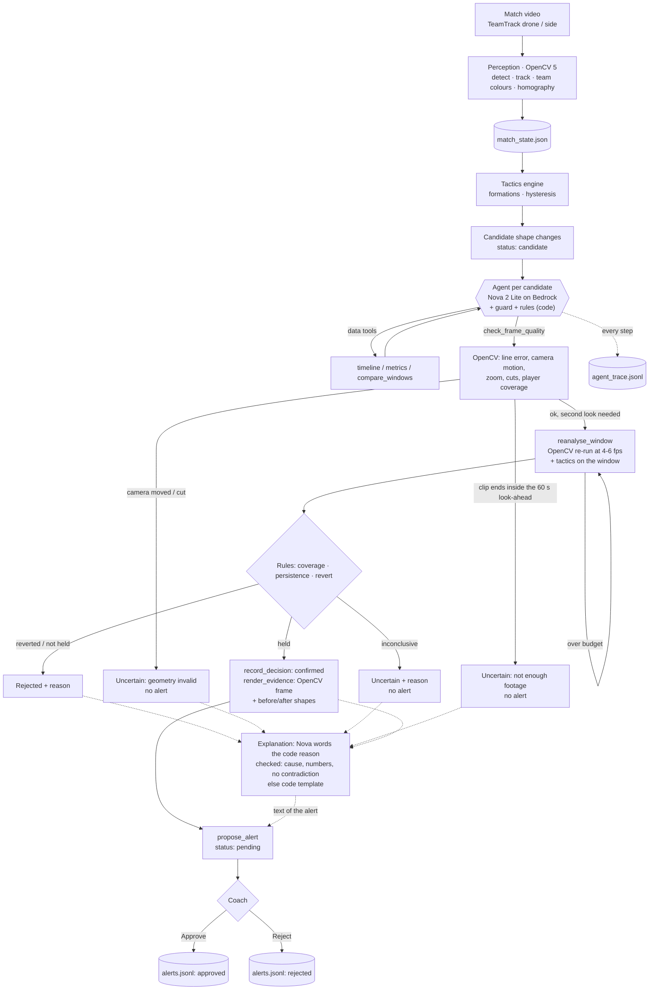

# Agent design (Phase 3)

Status: **approved 15 Oct** with the answers in §13 and three changes (exact success bar in §8, number matching cut from §5, spike spend cap in §11). All example values in tool results and traces are **illustrative**, not measured.

The agent takes each **candidate** shape change from the tactics engine and ends it in one of three states: **confirmed** (evidence rendered, alert pending coach approval), **rejected** or **uncertain**. Each state comes with a reason. To decide, it asks OpenCV to look again. That second look sets the next step, and the trace records it.

---

## 1. What the design has to live with (Phase 2 facts)

| Fact | Consequence for the agent |
|---|---|
| Drone (top) view is reliable; side view is experimental (IDF1 0.23, team acc. ~90 %, formation agreement 58–83 %) | `camera_trust` per view in config (`top: reliable`, `side: experimental`). Side candidates are capped at **uncertain** (decided, §13) |
| Drone pipeline never sees the ball (0 / 540 frames) | **No rule reads the ball, possession or pressing, on synthetic data too.** Synthetic numbers stay transferable to real footage. Set pieces are not detected as such. They are short and revert, so the persistence/revert checks catch them. Ball-based set-piece detection is **cut** |
| The candidate generator over-emits (seeds 110–119: 34 FP, 34 / 38 hits; 4 changes never emitted) | The agent's job is to reject. It cannot recover the 4 misses, so its ceiling is **34 / 38** |
| **Dev seeds 42–52** (`outputs/eval_synthetic.json`): **21 of 27 FPs** have a reverse FP of the same team within 60 s (out-and-back pairs: set pieces, phase-of-play flips) | The main ball-free signal: **does the new shape persist after detection, or revert?** Still unknown: how many true changes are followed by a quick flip back (build step 1 measures it). Seeds 110–119 are not looked at |
| Real drone candidates also come in pairs (eval2: home 1345 → 1400 s; eval: oracle home 1695 → 1755 s) | Even the **oracle contains out-and-back pairs**, so oracle candidates are not tactical truth (§8, §13) |
| Pan/zoom cameras unsupported | `check_frame_quality` measures camera motion, zoom and cuts with OpenCV and **refuses** (uncertain, no re-analysis) when the geometry is not valid |
| Bedrock: Nova 2 Lite (`global.amazon.nova-2-lite-v1:0`), fallback Nova Micro, Sydney, **20 requests/min** | Client-side rate limiter at 18 RPM, short per-candidate conversations, per-match call/token/cost caps, rules-only fallback (§6) |
| Re-analysis cost on the laptop CPU: top ~1.2–1.4 s per s of video at 4 fps, side ~5.5 s/s | Re-analysis windows are short (~145 s), budget-checked before running, and cached on disk |

---

## 2. Tools

Ten tools: the nine requested plus **`record_decision`**, a terminal tool that writes the verdict as structured data. Parsing free text for the verdict would be fragile.

Every result carries `ref` (`R1`, `R2`, … per candidate), which is the citation handle. Every result stays **≤ 1 KB** (enforced by a test). Times are match seconds plus a `clock` string (`"22:25"`), so the LLM never converts units itself. Inputs are validated with pydantic models whose JSON schema is what Bedrock receives (`additionalProperties: false` everywhere). An invalid call returns an error result and is never executed.

**Backends.** Data tools always read the MatchState and the tactics engine's in-memory result (window labels and engine-internal `detected_at_s`). Vision tools have three backends, named in every result as `backend`:
- `video` (real clips): **runs OpenCV 5** on the source video.
- `synthetic` and `annotation` (synthetic matches, TeamTrack oracle): there is no video, or the video is ground truth. "Quality" is computed from the MatchState, and "re-analysis" re-runs the tactics engine on the window at the MatchState's full frame rate (2 fps instead of the engine's 1 fps). This backend is labelled as such and is **never presented as video analysis**. Synthetic video is not rendered (cost; it would add no information).

### Data tools

**`get_match_overview`**: the match, its source and view, what is unavailable.
```json
{"type":"object","additionalProperties":false,"properties":{}}
```
```json
{"ref":"R1","match_id":"top_eval2","source":"video","view":"top","camera_trust":"reliable",
 "footage_s":[1260.0,1530.0],"teams":{"home":"White","away":"Blue"},"candidates":6,
 "uncertain_fraction":0.04,"unavailable":["ball","possession","pressing"],"warnings":[]}
```

**`get_formation_at`**: the 30 s window label ending at `t`, plus its segment.
```json
{"type":"object","additionalProperties":false,"required":["team","t"],
 "properties":{"team":{"enum":["home","away"]},"t":{"type":"number","minimum":0}}}
```
```json
{"ref":"R2","team":"home","t":1380.0,"clock":"23:00","label":"3-4-3","confidence":0.71,
 "visible_mean":9.2,"segment":{"start_s":1345.0,"end_s":1400.0,"formation":"3-4-3"}}
```

**`list_candidate_changes`**: at most 10, by time.
```json
{"type":"object","additionalProperties":false,
 "properties":{"team":{"enum":["home","away"]},"from_s":{"type":"number","minimum":0},
               "to_s":{"type":"number","minimum":0},
               "status":{"enum":["candidate","confirmed","rejected","uncertain"]}}}
```
```json
{"ref":"R3","total":6,"returned":2,"candidates":[
 {"id":"evt_002","t":1345.0,"clock":"22:25","team":"home","from":"4-4-2","to":"3-4-3","conf":0.87,"status":"candidate"},
 {"id":"evt_003","t":1400.0,"clock":"23:20","team":"home","from":"3-4-3","to":"4-4-2","conf":0.92,"status":"candidate"}]}
```

**`get_metrics`**: shape metrics over a window (≤ 600 s). Null metrics are listed under `unavailable` instead of being returned.
```json
{"type":"object","additionalProperties":false,"required":["team","start_s","end_s"],
 "properties":{"team":{"enum":["home","away"]},"start_s":{"type":"number","minimum":0},
               "end_s":{"type":"number","minimum":0}}}
```
```json
{"ref":"R4","team":"home","window":[1255.0,1345.0],"frames":90,"coverage":0.93,
 "defensive_line_m":31.2,"width_m":44.8,"compactness_m":27.5,"centroid_x":49.1,
 "unavailable":["possession","pressing"]}
```

**`compare_windows`**: formation shares and metrics in two windows. This is the data-side persistence check.
```json
{"type":"object","additionalProperties":false,"required":["team","a_start","a_end","b_start","b_end"],
 "properties":{"team":{"enum":["home","away"]},"a_start":{"type":"number"},"a_end":{"type":"number"},
               "b_start":{"type":"number"},"b_end":{"type":"number"}}}
```
```json
{"ref":"R5","team":"home",
 "a":{"window":[1300,1345],"shares":{"4-4-2":0.83,"3-4-3":0.17},"majority":"4-4-2","confident":9,"coverage":0.93},
 "b":{"window":[1380,1440],"shares":{"4-4-2":0.58,"3-4-3":0.42},"majority":"4-4-2","confident":12,"coverage":0.61},
 "delta":{"line_m":-1.4,"width_m":3.9},"rules":{"verdict":"need_more","failed":[],"missing":["second_look"]}}
```

### Vision tools (OpenCV on the `video` backend)

**`check_frame_quality`**: samples `agent.vision.quality_frames` (6) frames in the window. For each frame it re-anchors to the calibration (`cv2.phaseCorrelate` + `cv2.findTransformECC`, as in `drift.py`) and measures the line error (`homography_ok`). Between consecutive samples it measures camera motion (shift from `cv2.phaseCorrelate`, scale from `cv2.estimateAffinePartial2D` on ORB matches, which detects zoom) and checks for cuts (`cv2.compareHist` on HSV histograms). From the stored MatchState it adds per-team coverage (share of frames with ≥ 8 outfield players). Cost: design guess ~1–3 s; **measured 8–13 s per call** on the 4K drone video (12 frames decoded with H.264 seeks + 6 ECC re-anchorings; 11 real windows, step 5), i.e. ~6 % of a candidate's OpenCV time next to a 104–178 s re-analysis.
```json
{"type":"object","additionalProperties":false,"required":["start_s","end_s","why"],
 "properties":{"start_s":{"type":"number","minimum":0},"end_s":{"type":"number","minimum":0},
               "why":{"type":"string","maxLength":120}}}
```
```json
{"ref":"R6","backend":"video","view":"top","window":[1300.0,1445.0],"frames_checked":6,
 "homography_ok_share":1.0,"line_error_m_median":0.05,"camera_shift_px_per_s_max":2.1,
 "zoom_change_max":0.004,"camera_cut":false,"coverage":{"home":0.58,"away":0.97},
 "ok":true,"problems":["home coverage 0.58 < 0.60"],"opencv_ms":2140,
 "rules":{"verdict":"need_more","failed":["coverage"],"missing":["second_look"]}}
```

**`reanalyse_window`**: `pipeline.run_window` on [start, end) at `sample_fps` (track = output = `sample_fps`). It reuses the full-match team colours and directions from `<match>.teams.json`, then runs the tactics engine on that window with `tactics.sample_fps = sample_fps`, giving 4–6× the frames per formation window. Allowed fps: top {4, 6}, side {4}. Windows snap to a 5 s grid and results are cached (`outputs/agent_cache/`). Before running, it estimates processing time (window × fps × measured s/frame from config) and refuses above `agent.vision.max_reanalysis_s` (360 s). The refusal tells the LLM how long a window fits, so the LLM can retry with a shorter one. With `event_id`, the result compares against that candidate. The span it must cover is **[t − 45 s, t_detected + 60 s]**.
```json
{"type":"object","additionalProperties":false,"required":["start_s","end_s","sample_fps","why"],
 "properties":{"start_s":{"type":"number","minimum":0},"end_s":{"type":"number","minimum":0},
               "sample_fps":{"type":"number","enum":[4,6]},"event_id":{"type":"string","pattern":"^evt_\\d{3}$"},
               "why":{"type":"string","maxLength":120}}}
```
```json
{"ref":"R7","backend":"video","window":[1300.0,1445.0],"sample_fps":6,"frames":870,"processing_s":171.4,
 "coverage":{"home":0.88,"away":0.99},
 "labels":{"team":"home","start_s":1315,"step_s":10,"seq":["4-4-2","4-4-2","4-4-2","3-4-3","3-4-3","3-4-3","4-4-2","4-4-2","4-4-2","4-4-2","4-4-2","4-4-2","4-4-2"]},
 "candidates_in_window":[{"t":1350.0,"team":"home","from":"4-4-2","to":"3-4-3"},{"t":1395.0,"team":"home","from":"3-4-3","to":"4-4-2"}],
 "vs_event":{"event_id":"evt_002","after_share_new":0.33,"reverted_after_s":45,"covers_required_span":true},
 "rules":{"verdict":"reject","failed":["persistence","revert"],"missing":[]}}
```
Error example: `{"ref":"R7","error":"over_budget","message":"estimated 512 s > 360 s","max_window_s_at_this_fps":100}`.

**As built (step 5, `agent/vision.py`).** Differences from the text above, decided while building:
- Camera motion is measured on **frame pairs 0.5 s apart** at each of the 6 sample times (ORB + `cv2.estimateAffinePartial2D` with RANSAC, so moving players are outliers), not between samples ~25 s apart. 0.2 s pairs were too coarse: at 960 px analysis width, 1 px of noise is 20 px/s against a 25 px/s limit. Consecutive samples are still compared for cuts (HSV histogram correlation < 0.5) and zoom drift; two samples that **no longer align at all** count as a view change (reported as a cut), and a pair that does not align means the camera moved too fast. Static views (side) check alignment with their calibration frame instead of line re-anchoring.
- Re-analysis on video covers exactly the requested window snapped outwards to 5 s (no extra `context_s`, which only the synthetic backend adds), tracking = output = `sample_fps`; the window MatchState goes through the same `MatchContext.tactics_pass` as the synthetic slice. Budget: window × fps × `agent.vision.s_per_frame[view]` (top 0.33 s) ≤ 360 s, and ≤ 1200 s of OpenCV per match; cache hits are free and never refused. Cache key = video, view, window, fps, team model and perception/detector config.
- The rules policy re-analyses at the **lowest** allowed rate, or at the highest when first-pass coverage is low, stepping down when OpenCV refuses on budget.
- `render_evidence` on video: inside the most confident look-ahead window in the new shape, the frame with most outfield players of the team; both teams' positions and the team's formation lines (template fit) are projected back into that frame through its own re-anchored homography, cropped to the pitch, above the two shape panels. Both shape panels use the **most confident window** of the old / new shape (latest pass first, then first pass); with none, the panel says "low visibility" instead of averaging partial frames. **Step 7:** a window with more than 25 % of the team's outfield positions inside its own penalty area (deep defending or a set piece) is skipped, and "before" searches 120 s back from the onset (`presentation.evidence`); if every window is packed the most confident one is drawn with an "ATYPICAL" note. The 16:30 demo alert's "before" panel moved from a packed 15:15–15:45 window (45 % in own box) to 15:05–15:35 (20 %).
- Alerts and the verified timeline show the **code-written** reason (`verify.decision_reason`) first; the model's text is kept as the separate "explanation" (spike 15 Oct). Every rules block carries `next_step`.
- **Explanation step (build step 7, 17 Oct; presentation only).** Right after a successful `record_decision` the loop calls `agent/explain.py` in its **own** conversation (own budget `presentation.explain`, shared rate limiter): Nova gets `facts` (decision, code reason, cause, the rule in plain words, the key numbers of the candidate's results by ref; never the engine's evidence string or the label strip) and writes 1-2 sentences, which a cheap check accepts or replaces with a code template (§5). The alert's explanation is this text, labelled `Explanation (agent)` or `Explanation (template)`; the free text of `record_decision` and `propose_alert` stays in the trace only (`decision_text`). The rules arm gets the template; a rules-arm runner given an explainer with an LLM gets Nova's words for the rules' decisions. The orchestration prompt and budget are unchanged, so decisions cannot depend on it (asserted on the 14 real candidates by replaying their traces). Settings live outside `agent:` so the frozen fingerprint stays `ca4ff9bbf7b01c6c`.

**`render_evidence`**: allowed only after `record_decision(confirmed)`. It decodes the frame where the new shape is most confident and draws team-coloured boxes (`render.annotate_frame`). Next to it go two minimaps: the team's average shape (template-slot means from the formation fit) before and after the change, labelled with formations and clocks. Output is **JPEG (quality 90), ≤ 1 MB, 1280 px wide** (changed 16 Oct, user-approved: a 400 KB PNG cap shrank a 4K evidence frame to ~570 px). Synthetic/annotation backends get the minimaps only.
```json
{"type":"object","additionalProperties":false,"required":["event_id","why"],
 "properties":{"event_id":{"type":"string","pattern":"^evt_\\d{3}$"},"why":{"type":"string","maxLength":120}}}
```
```json
{"ref":"R9","image":"outputs/evidence/top_eval2/evt_004.jpg","frame_t":1497.5,"clock":"24:57",
 "shows":["frame with team boxes","average shape 23:50-24:25 vs 24:35-25:30"],"bytes":212000,"opencv_ms":950}
```

### Decision and action tools

**`record_decision`**: exactly once per candidate. The guard checks the decision against the rules verdict (§4) and checks that every citation exists.
```json
{"type":"object","additionalProperties":false,"required":["event_id","decision","reason","citations"],
 "properties":{"event_id":{"type":"string","pattern":"^evt_\\d{3}$"},
   "decision":{"enum":["confirmed","rejected","uncertain"]},
   "reason":{"type":"string","maxLength":200},
   "citations":{"type":"array","minItems":1,"maxItems":5,"items":{"type":"object","additionalProperties":false,
     "required":["ref"],"properties":{"ref":{"type":"string","pattern":"^R\\d+$"},"t":{"type":"number"}}}}}}
```
```json
{"ref":"R8","ok":true,"event_status":"confirmed","next":"render_evidence"}
```
```json
{"ref":"R8","error":"not_allowed","message":"rules verdict is 'reject' (R7: persistence, revert); 'confirmed' is not allowed"}
```

**`propose_alert`**: allowed only for a confirmed candidate with rendered evidence. It creates a **pending** alert in `outputs/alerts.jsonl`. The explanation must cite ≥ 1 `[Rn]`.
```json
{"type":"object","additionalProperties":false,"required":["event_id","title","explanation","suggestion"],
 "properties":{"event_id":{"type":"string","pattern":"^evt_\\d{3}$"},"title":{"type":"string","maxLength":80},
   "explanation":{"type":"string","maxLength":280},"suggestion":{"type":"string","maxLength":160}}}
```
```json
{"ref":"R10","ok":true,"alert_id":"alr_top_eval2_evt_004","status":"pending",
 "evidence_image":"outputs/evidence/top_eval2/evt_004.jpg"}
```

---

## 3. The loop

The orchestrator is `agent/loop.py`. Candidates are taken in time order, with one short Bedrock conversation per candidate. Code builds the first message (the **candidate card**), so the common context costs no LLM call:

```
Candidate evt_002 | match top_eval2 | source video | view top (camera trust: reliable)
home, onset 1345.0 s (22:25), detected 1380.0 s, 4-4-2 -> 3-4-3, engine confidence 0.87
engine evidence: "back line 4->3, front line 2->3; held 20s; 9.1/10 outfield visible"
same team within 120 s: evt_003 1400.0 s 3-4-3 -> 4-4-2
other team within 30 s: evt_001 away 1345.0 s 3-4-3 -> 4-4-2
footage 1260-1530 s; unavailable: ball, possession, pressing
rules: missing [quality_check, second_look]; required re-analysis span [1300, 1440]
```

```
for each candidate:                      # perceive -> decide -> act
    msgs = [card]
    while not done and llm_calls < 8:
        r = bedrock.chat(msgs, tools, tool_choice="any")      # rate-limited, budgeted
        for call in r.tool_uses:
            res = guard.check(call) or tools.run(call)        # schema, protocol, repeats, budget
            verdict = verify.update(candidate, res)          # deterministic, attached to res
            trace.write(step)
        msgs += [r.message, tool_results]
    if not done: rules_fallback(candidate)                   # decided_by "guard"
then: verified timeline, coach report (1 call), alerts stay pending for the coach
```

`tool_choice="any"` means every turn is a tool call; `record_decision` ends a rejected or uncertain candidate, and `propose_alert` ends a confirmed one. Nova's support for `any` gets checked in build step 4.

### Situations where a vision result changes the next step

All five become mocked-LLM tests (§9). The real-footage runs in §8 are expected to produce traces like them.

**A. Camera not usable → refuse, no re-analysis, no alert.** (Tested on a simulated pan: a sliding, zooming crop of a drone clip. The real hard-mode clip is not held.)

| step | tool | key result | next step |
|---|---|---|---|
| R1 | `check_frame_quality` | `camera_shift_px_per_s_max` 140, `zoom_change_max` 0.21, `homography_ok_share` 0.17, verdict `refuse` | re-analysis cannot fix a moving camera → `record_decision(uncertain, "camera pans/zooms in 22:10–24:00 (R1): pitch geometry invalid, no formation reading")` |

**B. Low coverage → second look at a higher rate → agrees → evidence → approval request.**

| step | tool | key result | next step |
|---|---|---|---|
| R1 | `check_frame_quality` | ok, home coverage 0.58 < 0.60 | re-analyse at the highest allowed rate: `reanalyse_window(1300, 1440, 6)` |
| R2 | `reanalyse_window` | coverage 0.88, `after_share_new` 0.83, no revert, verdict `confirm` | `record_decision(confirmed, cites R2)` |
| R3 | `record_decision` | `next: render_evidence` | `render_evidence(evt_004)` |
| R4 | `render_evidence` | PNG at 24:57 | `propose_alert` → **pending**, waits for the coach |

**C. Second look disagrees → reject.**

| step | tool | key result | next step |
|---|---|---|---|
| R1 | `check_frame_quality` | ok, coverage 0.93 | still needs a second look (video rule) → `reanalyse_window(1300, 1440, 4)` |
| R2 | `reanalyse_window` | 3-4-3 holds 33 % after detection, reverts after 45 s, verdict `reject` | `record_decision(rejected, "3-4-3 held 33 % of windows and reverted to 4-4-2 after 45 s at 4 fps (R2)")`. evt_003, the return leg, is then rejected as a revert of evt_002 |

**D. Inconclusive → uncertain, not alerted.**

| step | tool | key result | next step |
|---|---|---|---|
| R1 | `check_frame_quality` | ok, away coverage 0.41 | `reanalyse_window(…, 6)` |
| R2 | `reanalyse_window` | over budget (window too long at 6 fps) | retry with the window that fits: `reanalyse_window(…, 4)` |
| R3 | `reanalyse_window` | coverage 0.52, `after_share_new` 0.55, verdict `uncertain` | `record_decision(uncertain, "only 52 % of frames show 8+ Blue outfield players (R3)")` |

**E. Data result skips vision (synthetic/annotation backend only).** `list_candidate_changes` shows that the candidate returns to the shape held before an earlier rejected candidate, within 60 s → reject as a revert with no vision call. **On real video, every decision except a refusal needs a second OpenCV look**, because a first-pass revert can be a perception artefact (eval2: away 1410 s is an oracle event, but the pipeline reverts at 1480 s). **Exception (16 Oct, user-approved):** when rule F fails (the clip ends inside the look-ahead), the verdict is uncertain after the camera check without a second look; F depends only on the window bounds, so no re-analysis can change it (step 5: 477 s of 1,545 s of real-clip re-analysis went to 4 such candidates, none changed).

---

## 4. Who decides what

The rules are the judge, and their verdict is code. The LLM orchestrates and writes, but it may never be **less cautious** than the rules.

### Deterministic checks (`agent/verify.py`, thresholds in `config.yaml: agent.verify`)

Set in build step 1 on dev seeds 42–52 and **frozen on 15 Oct** (`scripts/eval_agent.py --set dev --grid`; values below are the frozen ones).

| check | from | pass | fail |
|---|---|---|---|
| G geometry | `check_frame_quality` (video) | `homography_ok` share ≥ 0.9, no cut, camera shift ≤ 25 px/s, \|zoom\| ≤ 3 % | → **refuse** |
| F footage | window bounds | ≥ 60 % of the 60 s look-ahead exists | → uncertain ("not enough footage after the change") |
| C coverage | MatchState (latest pass) | ≥ 60 % of frames with ≥ 8 outfield of the team, before and after | → need_more (**a second look first**); after the second look it never blocks a verdict. Changed in step 1: as a hard gate it blocked 13 of 39 real changes on dev, all with ≥ 4 confident look-ahead windows (a confident window already needs ≥ 8 visible players) |
| P persistence | window labels in [t_det, t_det + 60 s], latest pass | new family ≥ 60 % of ≥ 3 confident windows | ≤ 40 % → reject; between, or < 3 confident → need_more / uncertain |
| R revert | candidates (latest pass) | no reverse change within 60 s of detection | reverse within 60 s, or return leg of a rejected candidate → reject |

*R experiment (17 Oct, OFF):* "a return leg is rejected only when P fails" (`agent.verify.return_leg_needs_failed_persistence`) would let the real oracle's away 4-4-2 → 4-2-3-1 at 18:50 (held 220 s) through, but on 42–52 + 100–109 it adds **25 false alerts and no hit** (leave-one-seed-out CV picks "off" in 21 / 21 folds): synthetic return legs that persist for 60 s are almost all flip-flops (15 of the 25 are 4-3-3 ↔ 4-2-3-1). FAILURE_LOG 2026-10-17.
| S second look | `reanalyse_window` covering the required span | done (required on `video` only; not required once F fails, 16 Oct) | → need_more |
| V view | config | top: no cap | side: verdict capped at uncertain (§13) |

**Latest pass wins:** once a re-analysis exists, C, P and R use the re-analysed data, not the first pass. That is how a vision result overturns a first-pass revert or confirms one.

Verdict order: G fail → refuse; C fail without a second look, or S missing → need_more; F fail → uncertain; R or P fail → reject; P pass → confirm (then V cap); otherwise need_more / uncertain (uncertain once no more evidence can be gathered). A confirmation also needs at least one vision tool call on every backend (guard).

### What the LLM may record

| rules verdict | allowed `record_decision` |
|---|---|
| confirm | confirmed, or uncertain with a reason (e.g. the other team changed at the same moment, a possible set piece) |
| reject | rejected |
| uncertain / refuse | uncertain or rejected |
| need_more | none: it must call a vision tool first. Uncertain is allowed once steps or budget run out |

### Why the split

- **Thresholds are code.** They are auditable, unit-tested and identical across runs, so the eval measures a policy and not sampling noise. A small model is unreliable at comparing 0.58 with 0.60 over several steps.
- **The LLM orchestrates.** It chooses the order, the window and the fps under the compute budget, recovers from tool errors (over budget → shorter window), uses neighbouring candidates of both teams, and decides when caution beats a confirmation.
- **The LLM writes.** It produces the coach-facing title, explanation and suggestion, plus the match report, all grounded in tool results (§5). Templates read badly. Phase 4 chat reuses the same tools.
- **The rules-only arm in the eval** (§8) measures what the LLM adds to *decisions*. If the answer is "nothing", the report says so, and the LLM's role is stated as orchestration and explanation.

### Why this is agentic, not a fixed pipeline with a chatbot

1. **The path depends on vision results.** The calls run from 2 (refuse) to 6 (confirm with retry), and their arguments (window, fps) come from earlier results. A fixed pipeline runs the same steps for every candidate.
2. **New perception is computed on demand.** `reanalyse_window` produces OpenCV output that did not exist before the call. A chatbot only explains results computed beforehand.
3. **The action depends on the vision result.** An approval request is only possible after OpenCV evidence; the guard enforces it, and the trace shows `prev_ref` → next tool for every step.

---

## 5. Grounding

- Every tool result has a `ref`. `record_decision.citations` must name refs from **this candidate's** trace, and a cited `t` must lie inside that tool's window (±5 s). Otherwise the call returns `not_allowed` and the model retries.
- `propose_alert.explanation` must contain ≥ 1 `[Rn]`. The UI renders it as a "how I checked this" link into the trace.
- Clocks in text (`mm:ss`) must fall inside a cited tool's window (±5 s), else `not_allowed`. Other numbers in the text are not matched against results (cut on 15 Oct); the citation and time-window checks are the grounding guarantee.
- Tool results omit unavailable metrics, and the card says "unavailable: ball, possession, pressing", so the model has nothing to cite for them.
- **Explanation check (build step 7).** Number matching came back for the coach-facing explanation only, where it is cheap: the facts are a few dozen numbers. `explain.check` flags a text that (1) does not name the code's cause (footage, revert, return leg, ...), (2) contradicts the decision (e.g. "not held" for a confirmation, or for a return leg that held 75 %), (3) uses a number or `mm:ss` clock that is not in the facts (with its unit: %, s, fps, readings), (4) mentions ball, possession, pressing or a confidence score, (5) cites a ref that does not exist, or (6) is longer than 2 sentences / 300 characters. A flagged text, an LLM error or a spent budget gives the code template, which is built from the same facts and passes the same check (tested for every cause). The check does not verify that a number sits in the very ref it is cited to (manual review on the 14 real candidates: all did).
- **Coach report** (`agent/report.py`): one call per match, inputs are decided events plus segment summaries. Every sentence that contains a number or time cites `[evt_004]` or `[seg 1260–1530]`. A failed check gets one retry, then a deterministic template.
  **As built (step 7, 17 Oct):** inputs = the decided events (code reason, explanation, before/after line, depth, width and own-box share of the same typical windows as the evidence panels) + the timeline segments (first pass); candidates the agent did not check are listed and cannot be cited. Citations are `[evt_003]` or `[seg 16:30-17:30]` (a run of consecutive segments allowed). `check_report`: every sentence with a number or `mm:ss` cites a decided event or a segment run, its numbers and clocks appear in the cited items, every bracket is a valid source, each "may have fixed" and each of exactly 3 recommendations rests on a cited number or time, both teams appear in the story, no ball / possession / pressing / confidence. The template passes the same check (tested). Prompt worked on dev seed 45 (5 runs, 3 prompt versions, 1 accepted); the 900–1260 s report ran once: Nova failed the check twice (second attempt only on a `[match.note]` citation; its content was grounded but tactically weak), so the **template** report is the one published (`outputs/agent_video_step7/report_w900_1260.md`, $0.0035). FAILURE_LOG 2026-10-17.

---

## 6. Failure handling and budgets (`config.yaml: agent.limits`)

| failure | handling |
|---|---|
| Throttling (transient) | existing client: backoff, 4 attempts; plus a **client-side token bucket at 18 RPM** so the 20 RPM quota is rarely hit |
| Quota exhausted (daily tokens) | stop LLM use for the run; remaining candidates go to the **rules-only path** (`decided_by: "rules (llm unavailable)"`, alert text from a template); `eval_agent.py --resume` continues later from the trace |
| Model access error / repeated call errors | switch to `apac.amazon.nova-micro-v1:0` (config); the model is logged per call |
| Malformed tool call (schema, unknown tool) | error result to the model, counts as a step; 2 in a row → rules fallback for that candidate |
| Tool error (video unreadable, OpenCV failure, over budget) | `{"error", "message", "retryable"}` to the model; it can pick another tool or window |
| Protocol violation (alert before verifying, confirm against the rules) | `not_allowed` with the reason; counts as a step |
| Looping | an identical call returns the cached result plus `"note":"repeated"`; a 3rd identical call ends the candidate |
| Text instead of a decision | one nudge, then the rules fallback |
| Max steps | **8 LLM calls, 3 vision calls (≤ 2 re-analyses) per candidate** → `uncertain`, `decided_by: "guard"` |
| Per-match caps | **150 LLM calls, 400 k tokens, $0.50** (prices per model in config) → remaining candidates go to rules; more than 30 candidates → the rest go to rules |
| OpenCV time | ≤ 360 s estimated per re-analysis, ≤ 20 min per match |

**Cost estimate** (to measure): ~4 calls per candidate × ~3 k input / 150 output tokens. A synthetic match has ~7 candidates, so ~85 k input + 4 k output, **≈ $0.04 per match**. That uses $0.30 / $2.50 per 1 M tokens for the global Nova 2 Lite profile, from third-party price lists; confirm on the AWS pricing page before relying on it. The whole Phase 3 eval is ≈ 3–4 M tokens, < $5. At 18 RPM a synthetic match needs ≥ ~2 min of LLM time.

---

## 7. Logs

### `outputs/agent_trace.jsonl` (one line per step)
```json
{"trace_id":"tr_20261016T0930_top_eval2_evt_002","match_id":"top_eval2","event_id":"evt_002","step":2,
 "ts":"2026-10-15T09:31:12Z","actor":"llm","kind":"tool_call","tool":"reanalyse_window",
 "args":{"start_s":1300,"end_s":1440,"sample_fps":4,"event_id":"evt_002","why":"R1 ok; video needs a second look"},
 "ref":"R2","prev_ref":"R1","backend":"video",
 "result_summary":{"coverage_home":0.88,"after_share_new":0.33,"reverted_after_s":45,"verdict":"reject"},
 "duration_ms":171400,"llm":{"model_id":"global.amazon.nova-2-lite-v1:0","in":2810,"out":88,"latency_ms":1900},
 "error":null}
```
- `actor`: `llm` | `guard` | `rules`. `kind`: `tool_call` | `guard_block` | `decision` | `fallback` | `match_summary`.
- `result_summary` is exactly what the LLM saw, minus long arrays.
- The `decision` line per candidate carries `decision`, `reason`, `citations` and `decided_by`.
- The `match_summary` line totals calls, tokens, cost, OpenCV time and guard blocks.
- The verified timeline (`outputs/<match>_timeline_verified.json`) fills the existing contract field `Event.verification` (`decided_by`, `decision`, `reason`, `tool_calls`, `evidence_image`, `trace_id`). **No contract change.**

### `outputs/alerts.jsonl` (append-only, contract `Alert` fields unchanged)
`alert_id = alr_<match_id>_<event_id>` keeps ids unique across matches without a new field. A coach decision appends the full alert again with the new status, and the **last line per `alert_id` wins**. So every decision is logged, and the history is never rewritten.
```json
{"alert_id":"alr_top_eval2_evt_004","event_id":"evt_004","created_utc":"2026-10-15T09:40:02Z","match_time_s":1465.0,
 "title":"White switched from 4-4-2 to 3-4-3 (24:25)","explanation":"... held 83 % of windows at 6 fps [R2] ...",
 "suggestion":"...","evidence_image":"outputs/evidence/top_eval2/evt_004.png","status":"pending","decided_utc":null,"coach_note":null}
{"alert_id":"alr_top_eval2_evt_004", "...":"same fields", "status":"approved","decided_utc":"2026-10-15T09:52:40Z","coach_note":"seen it"}
```
Phase 3 has a CLI for the coach (`py -m gaffer.agent.alerts --approve|--reject <id> [--note]`); Phase 4 adds UI buttons on the same store. Approving twice, or approving an unknown id, is an error.

---

## 8. Evaluation (`scripts/eval_agent.py`)

**Arms:** (a) **one-shot**: alert on every candidate; (b) **rules-only**: same tools, fixed order, no LLM, cost 0; (c) **agent**: Nova 2 Lite. Arms (b) and (c) share the re-analysis cache.

**Data and order (no peeking):**
1. Dev seeds **42–52**: set thresholds (step 1), tune the prompt (step 4).
2. Seeds **100–109**: validation; seen by the engine, never by the agent. Reported, not tuned on. **Exception (17 Oct, user-approved): they became development data for one bounded experiment** (Task A: a metric check on 4-3-3 ↔ 4-2-3-1 candidates, threshold by leave-one-seed-out CV over 42–52 + 100–109). It did not clearly help (CV false alerts 23 → 19, real changes 67 → 66; −5 was required) and is **OFF** (FAILURE_LOG 2026-10-17). Validation numbers on 100–109 reported before 17 Oct stay valid (no rule changed).
3. Seeds **110–119**: **run once** with the frozen config. **Frozen 17 Oct** after Task A and the return-leg experiment (§4; both OFF): no threshold or rule change afterwards; `eval_agent.py` stores a fingerprint of the `agent` / `tactics` / `bedrock` / `synthetic` / `formations` config (`ca4ff9bbf7b01c6c`) and refuses to resume the LLM arm if it changes. **Not unseen:** the tactics engine's output on 110–119 was already seen in Phase 2 (one-shot baseline 34 false positives, 34 / 38 hits; the 4-3-3 family option measured there). The set is **agent-untouched** (no agent rule, threshold or prompt was ever run or tuned on it), not unseen data.
4. Real drone: **dev** (30 s, 0 candidates: smoke only), **eval** 1560–1800 s (4 pipeline candidates), **eval2** 1260–1530 s (6). Each runs on the pipeline MatchState (`video` backend) and on the oracle (`annotation` backend).
5. Side eval2: one candidate, to show the conservative behaviour.

**Metrics per arm.**
- Alerts on true changes: a hit within ±90 s, as in `eval_synthetic.py`; strict variant also requires the right new formation.
- False alerts.
- Missed true changes, including the 4 never emitted.
- Uncertain count, split hit / FP.
- Rejected hits.
- Alert delay on the match clock: the decision is available at t_det + look-ahead.
- LLM calls, tokens, cost per match.
- Wall time per candidate (LLM vs OpenCV).
- Guard blocks and fallbacks.

**Success criteria, fixed now, judged on seeds 110–119.** The one-shot baseline is 34 false alerts and 34 / 38 alerted. The free config option (4-3-3 family) gives 16 / 28.
- **The bar, fixed on 15 Oct before any run (it does not move afterwards): false alerts ≤ 16 AND alerted true changes ≥ 30 of 38 on seeds 110–119.** That is no worse than the 4-3-3-family config option (16 FP, 28 hits) on false alerts and strictly better on hits, so one config line cannot match it.
- **Agent helps** only if the bar holds **and** uncertain **≤ 30 %** of candidates **and** mean alert delay **≤ 120 s**.
- **Agent did not help** if false alerts > 25, or it does not beat the config option (16 FP, 28 hits), i.e. false alerts > 16 with hits ≤ 28. Anything else that misses the bar is reported as a partial result.
- **The LLM adds to decisions** only if the agent arm beats rules-only by ≥ 2 false alerts or ≥ 2 hits without losing on the other. Otherwise the report says decisions come from the rules.
- Cost: mean ≤ $0.10 and ≤ 60 LLM calls per synthetic match; p95 LLM time per candidate ≤ 30 s.

**Real footage: no accuracy claims.** There are 10 pipeline candidates, all from one match (eval and eval2 are neighbouring minutes, same teams and cameras). There is also no tactical truth: the oracle contains its own out-and-back pairs. What gets reported:
- A per-candidate decision table.
- **Decision agreement, pipeline vs oracle**: does perfect perception lead to the same decision?
- OpenCV time per vision call.
- Required evidence: (1) ≥ 1 real trace where an OpenCV result changes the next call and the decision; (2) a simulated-pan window refused; (3) a candidate rejected because re-analysis did not confirm it (PLAN acceptance). If (3) does not happen on real footage, it is reported as not met there, not forced.

---

## 9. Tests (pytest, LLM always mocked)

- **No Bedrock in pytest:** an autouse fixture makes `boto3` client creation for `bedrock-runtime` raise. `FakeBedrock` replays scripted `converse` responses, the same stub style as `test_bedrock_client.py`.
- **Tool schemas:** each pydantic model ↔ JSON schema; the doc's example args validate; every result ≤ 1 KB; unavailable metrics never appear as numbers.
- **`verify.py`:** a table of window-label sequences → verdict (persist, revert, return leg, low coverage, missing footage, camera refuse, side cap, latest pass wins).
- **Loop scenarios A–E (§3)**, plus: alert before verifying → blocked then recovered; confirm against a reject verdict → blocked; malformed args twice → fallback; identical call ×3 → stop; 8-step limit → uncertain; quota exhausted mid-match → rules fallback for the rest; per-match token cap.
- **Vision tools on generated frames** (no TeamTrack files in CI): a drawn pitch, static → ok; translated/zoomed sequence → `refuse`; hard switch to another image → cut; re-analysis budget refusal and cache hit; `render_evidence` writes a PNG.
- **Alert store:** pending → approved/rejected, last line wins, double approval and unknown id rejected.
- **Trace:** required fields, `prev_ref` chain, totals in `match_summary`.
- **Grounding:** unknown ref / cited time or `mm:ss` clock outside the cited window → blocked.
- **Rate limiter and caps** with a fake clock. **Eval scoring** on hand-made candidate / GT lists.

---

## 10. Workflow diagram

Rendered to `docs/agent_workflow.png` in build step 7 (17 Oct) with mermaid-cli 11.17.0 (MIT) through npx, using the local Chrome (no browser download): extract this block to `agent_workflow.mmd`, then `npx -y @mermaid-js/mermaid-cli@11.17.0 -i agent_workflow.mmd -o docs/agent_workflow.png -b white -s 2 -p puppeteer.json` with `{"executablePath": "<path to chrome.exe>"}` in `puppeteer.json`. Updated in step 7 to the as-built flow: `record_decision` before `render_evidence`, the footage branch without a second look (16 Oct), and the checked explanation step (§2, §5).



---

## 11. Build order (≈ 2 days, riskiest first)

| # | step | ~h | acceptance |
|---|---|---|---|
| 1 | **`verify.py` + rules-only policy on the synthetic backend**, run on dev seeds 42–52 (no LLM, no OpenCV) | 2 | Rules arm on dev: false alerts ≤ 13 of 27 **and** ≥ 37 of 39 hits kept; thresholds frozen; validation 100–109 reported. **If this fails, stop and discuss:** ball-free checks cannot beat the baseline, and nothing else matters |
| 2 | `tools.py`: pydantic schemas, data tools, synthetic/annotation backends, `record_decision` | 2 | Schema/size tests pass |
| 3 | `loop.py` (guard, budgets, rate limiter, fallback), `alerts.py` (+ CLI), trace writer | 2.5 | Scenario tests A–E and failure tests pass; no Bedrock in pytest |
| 4 | **Bedrock spike**: ~10 dev candidates, expected ≤ 60 calls / ~$0.05; **hard caps 100 calls and 1 USD** (the run aborts when either would be exceeded) | 1 | ≥ 90 % finish with a valid decision without a fallback; ≤ 5 calls per candidate on average; `tool_choice=any` works on Nova. If < 70 %: simplify the prompt / tool set before going on |
| 5 | Video backend: `check_frame_quality`, `reanalyse_window` (+ cache, budget), `render_evidence` | 3 | Simulated pan refused; a 145 s top re-analysis at 4 fps < 4 min on the laptop; evidence PNG for one confirmed candidate; tests on generated frames |
| 6 | `eval_agent.py`: dev → freeze → 100–109 → **110–119 once** → real top (pipeline + oracle) → side 1 candidate | 2.5 | Numbers written to CLAUDE.md Key numbers; criteria from §8 judged as written |
| 7 | `report.py`, `agent_workflow.png`, trace excerpt with situations A–C, FAILURE_LOG entries | 1.5 | PLAN Phase 3 acceptance all ticked |

**Cut first, in order:** (1) `report.py` LLM version → template summary; (2) the agent arm on 100–109 (rules arm only there); (3) side-view re-analysis (side stays capped at uncertain); (4) agent runs on the oracle MatchState. (Number matching in grounding was already cut on 15 Oct.)
**Never cut:** video-backend vision tools, guard, approval flow, trace, one-shot vs agent on 110–119.

---

## 12. Risks

1. **Ball-free checks may not separate real changes from phase-of-play flips.** A real 4-3-3 → 4-2-3-1 change that flickers back with possession would be rejected. *First test:* step 1 on dev. *If hits drop by > 2:* map revert-only evidence to **uncertain** instead of reject (no false alert, and the coach can still see it in the timeline), and report the trade-off.
2. **Nova 2 Lite tool-use reliability.** It may skip steps, produce bad arguments or loop. *Test:* step 4 spike before the video work. *Mitigation:* guard, `tool_choice=any`, short per-candidate conversations, rules status in every result, rules fallback; the trace counts guard blocks, so the problem shows up in the numbers.
3. **Re-analysis compute time.** Top runs at ~1.3–2 s per s of video, side at ~5.5 s/s, so a real candidate takes minutes, which is slow for a live demo and for the eval. *Mitigation:* ~145 s windows, budget refusal, disk cache shared by arms, side capped. EC2 size and a short demo window are decided in Phase 4.
4. **Real-footage numbers are anecdotes.** There are ~10 candidates from one match and no tactical truth, and the oracle has out-and-back pairs. *Mitigation:* the quantitative claim rests on seeds 110–119; real clips give traces, decision tables and pipeline-vs-oracle agreement, and the report says so.
5. **The look-ahead delays alerts.** Expected ~100 s after the change instead of ~42 s. Candidates near the end of a clip become uncertain (4.5 min clips). *Mitigation:* measured and reported; Phase 4 live replay shows "verifying" for 60 s.

---

## 13. Decisions (answered by the user, 15 Oct)

1. **Look-ahead: yes.** Verification waits for 60 s of play after detection (alerts ~100 s after the change instead of ~42 s).
2. **Side view: capped.** Side candidates are at most "uncertain: experimental camera". No side re-analysis confirmation. (Step 7: the recorded reason of an uncertain side candidate now starts with exactly that, the evidence follows as detail; `Toolbox.recorded_reason`.)
3. **Real clips:** reported as decision tables + pipeline-vs-oracle decision agreement; no false-alert / miss rates on real footage.
4. **Bedrock quota: unknown**, and no Service Quotas permission will be added. The step 4 spike measures what we get; the quota-exhausted rules fallback and `--resume` stay as designed. Throttling is reported to the user.
5. **Rules-only arm: published**, even if it shows the LLM adds little to decisions.

---

## 14. Results (build step 6, 17 Oct): source for the technical report

Rules frozen 17 Oct (config fingerprint `ca4ff9bbf7b01c6c`) after two development-only experiments, both OFF: Task A (4-3-3 ↔ 4-2-3-1 metric check: CV false alerts 23 → 19, real changes 67 → 66; −5 was required) and "persistence beats the return-leg rule" (+25 false alerts, 0 hits on 42–52 + 100–109). FAILURE_LOG 2026-10-17.

### Final eval, seeds 110–119 (run once, 17 Oct; agent-untouched, not unseen: the engine's output was seen in Phase 2)

| arm | alerted real changes | false alerts | uncertain | rejected real | mean alert delay | LLM calls | cost |
|---|---|---|---|---|---|---|---|
| one-shot (alert every candidate) | 34 / 38 | 34 | 0 % | 0 | 42 s | 0 | 0 |
| rules only (no LLM) | **32 / 38** | **9** | 2 % (1 / 68) | 2 | 105 s | 0 | 0 |
| agent (Nova 2 Lite) | **32 / 38** | **9** | 2 % (1 / 68) | 2 | 105 s | 195 (2.9 / cand.) | $0.21 ($0.021 / match) |

Judged as written in §8: bar (≤ 16 false alerts AND ≥ 30 / 38) **met**, uncertain ≤ 30 % met, delay ≤ 120 s met → **"agent helped"**: false alerts −25 (−74 %) for −2 real changes. Cost limits met (max 39 calls per match, p95 LLM time 5.7 s per candidate, no throttling). **The LLM adds nothing to decisions:** 68 / 68 agree with the rules arm (0 guard blocks, 0 fallbacks). Decisions come from the deterministic rules; the LLM's role is orchestration (window, rate) and text, and its text is weak (31 / 41 alert explanations repeat the engine's "held 20 s").

### Real footage (one match, no accuracy claims)

- **Oracle, whole first half 0–1800 s:** 43 candidates; 8 hold ≥ 2 min with ≥ 60 % of windows in the new shape, 6 of them returns to the usual 4-4-2; 2 move away from it (home 4-4-2 → 3-4-3 at 16:30, 130 s; away 4-4-2 → 4-2-3-1 at 18:50, 220 s). Rules on the oracle: 6 confirmed, 32 rejected, 5 uncertain; the 18:50 change is rejected by rule R as a return leg.
- **Pipeline, drone eval + eval2 (11) and side eval2 (1), rules and Nova:** identical decisions (12 / 12): 7 rejected, 5 uncertain (4 within 60 s of the clip end, 1 side: re-analysis over budget), 0 confirmed. Nova cost $0.037 (35 calls).
- **Demonstration window 900–1260 s** (selected because the oracle shows both sustained changes in it): the pipeline finds both; **home 4-4-2 → 3-4-3 at 16:30 is confirmed** by both arms (first-pass coverage 52 % → re-analysis at 6 fps, 252 s, 91 % held) with a real-frame evidence JPEG and a pending alert; away 18:50 is rejected by R. Pipeline 424 s (1.18 s/s); Task E OpenCV total ≈ 19 min.

### Agentic Vision evidence status (plain)

1. **OpenCV result changes the next call AND the decision, on real frames:** only the **simulated pan/zoom** (real drone frames, synthetic camera motion): `check_frame_quality` measures 190 px/s, 30 % zoom, lines fit 33 % → refuse → no re-analysis → uncertain, where the first pass alone says reject. **No genuinely real case exists:** on 14 real candidates the decision always equals the first pass alone. The closest: demo evt_003, where low first-pass coverage (52 %) makes the second look run at the highest rate (6 fps instead of 4): the next call's arguments change, the decision (confirm) does not.
2. **Re-analysis contradicts a first-pass finding on a real clip:** eval evt_001 (away 3-5-2 → 4-4-2, 26:35): first pass "reverted after 55 s"; the second look at 4 fps and at 6 fps finds no revert but the new shape in only 17 % of windows → still rejected, with a different reason. Decision unchanged, reason changed.
3. **Confirmed alert with an evidence image on real footage: yes, one** (demo window evt_003, `outputs/agent_video_taskE/evidence/teamtrack_top_w900_1260/evt_003.jpg`), in a window chosen with the oracle, so it is a demonstration; its "before" panel showed a likely set piece (FAILURE_LOG), re-rendered in step 7 with a typical 4-4-2 (`outputs/agent_video_step7/evidence/teamtrack_top_w900_1260/evt_003.jpg`). On the eval / eval2 sets no candidate is confirmed. Confirmed alerts with evidence otherwise exist on synthetic matches (41 in the final run, shape panels only) and on generated frames (tests).

### Build step 7 (17 Oct): presentation and explanation only, decisions unchanged

| item | before | after |
|---|---|---|
| Real-footage explanations (14 candidates, decisions replayed from the traces and asserted equal, both arms) | 7 / 14 wrong (contradict the decision or name another cause); 12 / 14 under a strict rubric (a number or claim not in the cited result) | **0 / 14 wrong** (strict: 0 / 14; 1 vague); Nova's text kept 13 / 14, template 1 (a false flag); 15 calls, $0.0049 |
| "held 20 s" in explanations | 31 / 41 synthetic alerts (final run, not re-run) | the explanation step never sees the engine's evidence string; dev seed 45: 0 / 10 |
| 16:30 evidence "before" panel | 15:15–15:45, 45 % of White's positions inside its own penalty area (likely set piece) | 15:05–15:35, 20 % (most confident window with ≤ 25 %; else an "ATYPICAL" note) |
| Side eval2 recorded reason | "no verdict after the evidence budget: …" | "uncertain: experimental camera (side view, never alerted); detail: second look refused, over budget (…); first pass: …" |
| Coach report (`agent/report.py`) | not built | built; the 900–1260 s report is the **code template** (Nova's version failed the grounding check twice, $0.0035); `outputs/agent_video_step7/report_w900_1260.md` |
| Workflow diagram | Mermaid source only | `docs/agent_workflow.png` (as-built flow) |
| Trace excerpts | in reports only | `docs/AGENT_TRACE_EXAMPLES.md`: situations (a) confirm with evidence, (b) second look contradicts the first pass, (c) refusal |

Bedrock spent in step 7 (from `outputs/llm_calls.jsonl`): real explanations $0.0049 (15 calls) + explanation prompt work on dev seed 45 $0.0117 (4 runs, 39 calls) + real report $0.0035 (2 calls) + report prompt work on dev seed 45 $0.0382 (5 runs, 3 prompt versions, 10 calls) = **$0.058**. Config fingerprint unchanged (`ca4ff9bbf7b01c6c`): all new settings live in `presentation:`.

## N3 — Event posture is advisory

The upload worker persists OpenCV events and completes deterministic verification before it calls
the separate posture analyzer. Only `confirmed` event records are eligible. Bedrock sees a bounded
projection of the stored event (shape metrics, clock windows, coverage/quality and verifier
summary); it does not get the raw match or annotation ground truth. It returns one of
`attacking | defensive | hybrid | unclear` with exact citations. The server checks the cited path,
value, unit, time window, metric quality, and whether multiple independent metric types support the
direction. Formation labels alone never establish posture. Top-view ball, possession, pressing, and
intent claims are not assumed.

The deterministic verifier remains the only authority for event status/reason and its match-clock
evidence boundary. The posture result, trace reference, and attempt/cost ledger are stored
separately; coach decisions remain append-only. If a confirmed event lacks sufficient post-event
metrics, Bedrock may request one short OpenCV window. The upload worker may execute that request
only with the still-available original video context, after onset and before the stored verification
boundary, within the existing video budget/cache and the posture sample/window limits. One follow-up
Bedrock assessment can consume those new metrics; further requests stop as `unclear`. The
persisted-event CLI has no video context and safely falls back if extra imagery is requested.

There is no public posture-write endpoint and replay does not trigger model calls. A small read-only
poll refreshes pending posture state; the UI hides the result until the match clock reaches
`verification_match_time_s`. Missing credentials, budget/pricing limits, timeout, throttle, malformed
responses, or invalid citations keep the verified formation event intact and save a labelled
deterministic `unclear` fallback where a result is persisted. N3 uses event-record schema 1.1 and DB
migration 3's call/cost attempt ledger; frozen MatchState and TacticalTimeline v1.0 are unchanged.
