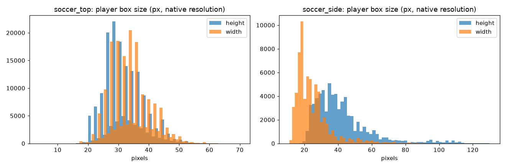
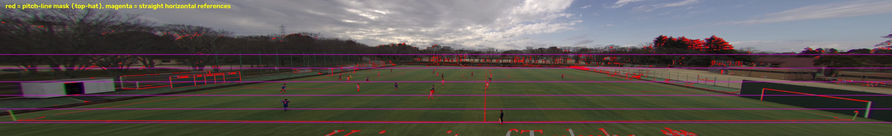
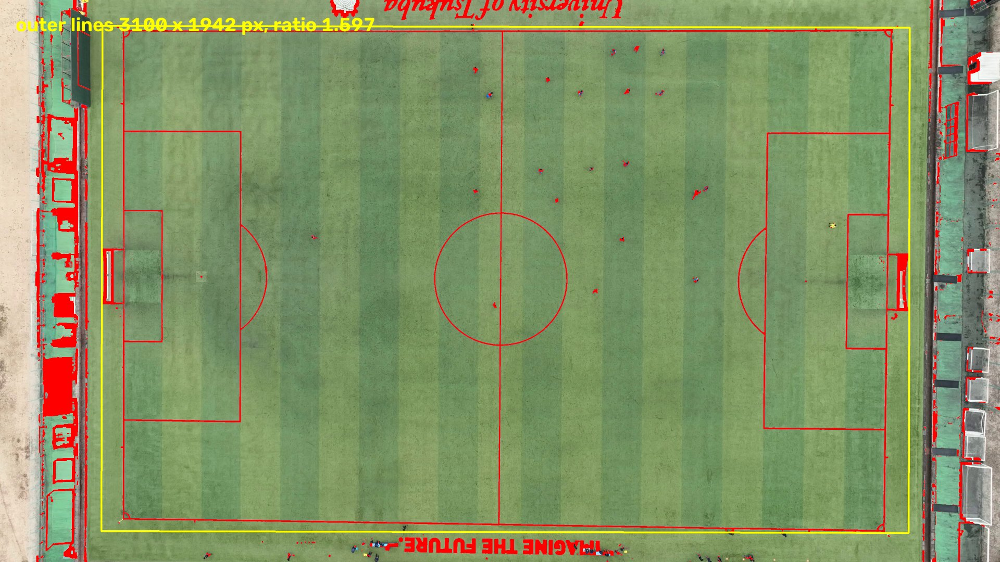
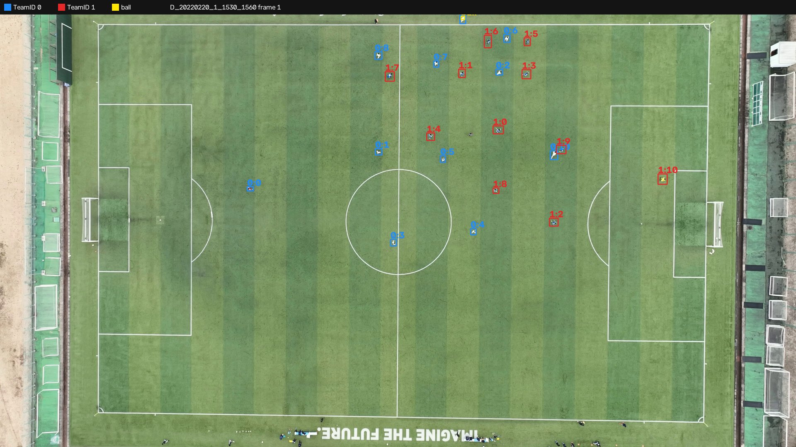
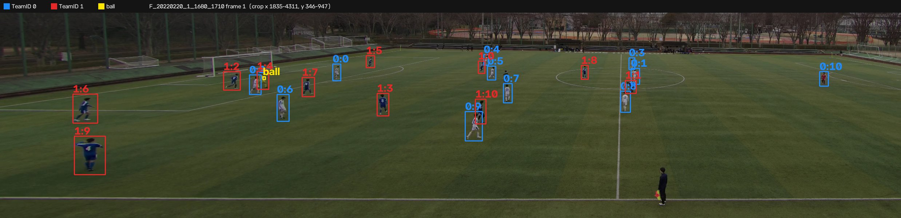
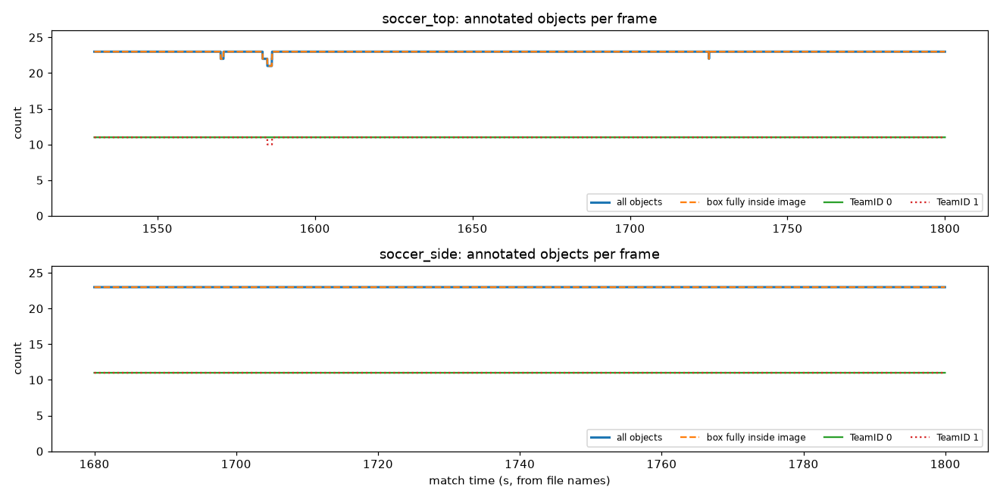

# DATA_NOTES — what the TeamTrack data actually looks like

Generated by `scripts/inspect_data.py` on 2026-10-09 (OpenCV 5.0.0, pandas 3.0.6). Re-run to refresh. Trust these numbers over assumptions.

Source: TeamTrack (Scott et al., 2024), Kaggle `atomscott/teamtrack`, MIT licence. Test split, subset of files.

## 1. Inventory

| view | clip | match time (s) | video MB | CSV | consecutive with previous |
|---|---|---|---|---|---|
| soccer_top | `D_20220220_1_1530_1560` | 1530–1560 | 27.5 | yes | — |
| soccer_top | `D_20220220_1_1560_1590` | 1560–1590 | 28.3 | yes | yes |
| soccer_top | `D_20220220_1_1590_1620` | 1590–1620 | 28.8 | yes | yes |
| soccer_top | `D_20220220_1_1620_1650` | 1620–1650 | 27.1 | yes | yes |
| soccer_top | `D_20220220_1_1650_1680` | 1650–1680 | 27.5 | yes | yes |
| soccer_top | `D_20220220_1_1680_1710` | 1680–1710 | 26.1 | yes | yes |
| soccer_top | `D_20220220_1_1710_1740` | 1710–1740 | 26.9 | yes | yes |
| soccer_top | `D_20220220_1_1740_1770` | 1740–1770 | 28.9 | yes | yes |
| soccer_top | `D_20220220_1_1770_1800` | 1770–1800 | 27.8 | yes | yes |
| soccer_side | `F_20220220_1_1680_1710` | 1680–1710 | 9.5 | yes | — |
| soccer_side | `F_20220220_1_1710_1740` | 1710–1740 | 8.2 | yes | yes |
| soccer_side | `F_20220220_1_1740_1770` | 1740–1770 | 8.4 | yes | yes |
| soccer_side | `F_20220220_1_1770_1800` | 1770–1800 | 8.8 | yes | yes |

- **soccer_top**: 9 clips, 9 with both video and CSV, covering match time 1530–1800 s (4.5 min) of half 1.

- **soccer_side**: 4 clips, 4 with both video and CSV, covering match time 1680–1800 s (2.0 min) of half 1.
- File name = `<camera>_<date>_<half>_<start_s>_<end_s>`; `D` = drone (top), `F` = fixed side camera. Video and CSV share the stem → pairing is by name.
- File names suggest the top and side clips are the same match (2022-02-20, half 1) with overlapping time 1680–1800 s. **Phase 2 measured otherwise:** after calibrating both views, no time offset in -270..+120 s, orientation or team-label mapping makes the two views' players coincide (best 14 m mean distance vs ~2 m for a true match), so the views are **not simultaneous** in these files (see FAILURE_LOG 2026-10-10). Treat them as independent footage.

## 2. Video metadata (OpenCV `VideoCapture`)

| view | resolution | fps | frames | duration | codec | CSV rows (frames) |
|---|---|---|---|---|---|---|
| soccer_top | 3840×2160 | 29.97 | 900 | 30.0 s | h264 | 900 |
| soccer_side | 6500×1000 | 25.00 | 750 | 30.0 s | h264 | 750 |

- soccer_top: decoding `D_20220220_1_1530_1560` frame-by-frame gave **900** frames (header says 900) → frame count matches the CSV.
- soccer_side: decoding `F_20220220_1_1680_1710` frame-by-frame gave **750** frames (header says 750) → frame count matches the CSV.
- All clips in a view share identical metadata: soccer_top: yes, soccer_side: yes.
- CSV `frame` runs 1…N; we assume CSV frame *k* = video frame index *k−1*. The GT overlays in §8 line up with the players, which supports this.
- Camera stability (`cv2.phaseCorrelate`, first vs last frame of each clip): soccer_top: median 4.7 px, max 9.3 px; soccer_side: median 0.3 px, max 0.4 px. The drone hovers rather than being locked, so a per-clip (or per-keyframe) homography is safer than one for the whole match.

## 3. CSV structure and how to load it

Three header rows, then a `frame` label row, then one row per frame:

```
TeamID,    0,        0,      0,     0,        0, ...,  1, ..., BALL,     BALL, ...
PlayerID,  0,        0,      0,     0,        1, ..., 10, ..., BALL,     BALL, ...
Attributes,bb_height,bb_left,bb_top,bb_width,bb_height,...
frame,,,,,...
1,20.0,1192.0,902.0,30.0,...
```

```python
wide = pd.read_csv(path, header=[0, 1, 2], index_col=0)   # 900 x 92 for a top clip
long = wide.stack(level=[0, 1], future_stack=True).dropna(how='all').reset_index()
# -> frame, TeamID, PlayerID, bb_height, bb_left, bb_top, bb_width
```

- 92 columns = 23 objects × 4 attributes. Column levels: `TeamID` ∈ {`0`, `1`, `BALL`}, `PlayerID` ∈ {`0`…`10`} (or `BALL`), `Attributes`.
- **Attribute order is alphabetical** (`bb_height, bb_left, bb_top, bb_width`) and **PlayerIDs sort as strings** (`0, 1, 10, 2, …`) — always index by name, never by position.
- Units: **pixels in the native video frame**; `bb_left`/`bb_top` = top-left corner. Values are floats; 13.5% (top) / 9.3% (side) are non-integer (interpolated?).
- Missing values: **644 NaN cells across all 13 CSVs**, always all four attributes of an object together:
  - `D_20220220_1_1560_1590`: 640 cells, objects 1/9, BALL/BALL, 117 frames between frame 304 and 792
  - `D_20220220_1_1710_1740`: 4 cells, objects BALL/BALL, 1 frames between frame 453 and 453
- Apart from those gaps, every object has a box in every frame, including players who are heavily overlapped by others — GT includes players a detector cannot see (caps recall in Phase 2).

## 4. Objects per frame and TeamIDs

- **soccer_top**: objects per frame min/mean/max = 21/23.0/23; TeamID 0 = 11, TeamID 1 = 11, BALL = 1 per frame. Boxes not fully inside the image: 0.00%. Player pairs overlapping (IoU > 0.3) per frame: 0.01.
- **soccer_side**: objects per frame min/mean/max = 23/23.0/23; TeamID 0 = 11, TeamID 1 = 11, BALL = 1 per frame. Boxes not fully inside the image: 0.00%. Player pairs overlapping (IoU > 0.3) per frame: 0.47.
- TeamIDs present: `0`, `1`, `BALL`. **No referee, no assistant referees, no explicit goalkeeper flag.** (The referee is visible in the top view and an assistant referee on the side view, both without GT boxes → a detector will produce "false positives" that are real people. Substitutes/staff beside the pitch are also visible in the top view.)
- Goalkeepers are inside the 11 per team. Most extreme mean x per team in the overlapping clip `20220220_1_1680_1710`:
  - soccer_top: TeamID 0: PlayerID 0 at mean x=579 px (team mean 1147 px); TeamID 1: PlayerID 10 at mean x=2446 px (team mean 1312 px)
  - soccer_side: TeamID 0: PlayerID 10 at mean x=4073 px (team mean 3368 px); TeamID 1: PlayerID 6 at mean x=2609 px (team mean 3186 px)
- In the top view these are the goalkeepers (they stand in their own penalty areas). In the side view TeamID 0's keeper has a **different PlayerID** and sits at the **opposite image side** (TeamID 1's keeper is out of the annotated range). → **TeamIDs agree between cameras, PlayerIDs do not**, and the drone image is rotated ~180° relative to the side camera (the pitch text reads upside down). Never join the two views on PlayerID. (Phase 2: the views turned out not to be simultaneous, so 'TeamIDs agree' rests only on shirt colours and keeper sides; it could not be checked.)
- PlayerID continuity across consecutive clips (foot point, last frame → next first frame): soccer_top: same id moves median 4 px vs nearest other player 147 px; soccer_side: same id moves median 2 px vs nearest other player 48 px → **IDs are consistent across clips**, so clips can be concatenated.

## 5. Box sizes (players, native pixels)

| view | width p5/p50/p95 | height p5/p50/p95 | ball w×h p50 | player height after full-frame letterbox to 640 (p50) |
|---|---|---|---|---|
| soccer_top | 25 / 34 / 46 | 22 / 30 / 44 | 14×13 | 5.0 px |
| soccer_side | 14 / 22 / 48 | 24 / 38 / 76 | 9×9 | 3.7 px |

- Top view: players are ~30 px blobs seen from directly above — **no human silhouette**. Phase 0 smoke test: COCO YOLOX-S in `cv2.dnn` finds **0** persons on the full top frame and on the native 640×640 centre crop (max objectness 0.06), and **1 of 12** GT players on a dense native 1280×640 region. See `docs/FAILURE_LOG.md`.
- **Phase 2 (14 Oct): side GT boxes are drawn with a margin.** Against the lowest moving-player pixel (temporal-median background, 566 isolated boxes), box bottoms sit a median **2 px (far rows) to 3 px (middle/near rows) below the feet**, and tops 3–7 px above the head. On the far side one pixel row is 0.4–1 m of depth, so the box bottom places a far player ~1 m nearer the camera than the feet. YOLOX boxes match this margin on the dev clip but end ~2.5 px higher on the other three clips. Detection scores are therefore reported raw and with the GT foot moved up 2.5 px (`teamtrack.views.side.gt_foot_inset_px`), near and far half separately (FAILURE_LOG 2026-10-14).
- Side view: players are taller than wide (median ~38 px high) and look like people; YOLOX finds 11 persons on a native 640×640 crop but **0 on the full 6500×1000 frame letterboxed to 640** (players shrink to ~4 px). → Phase 2 needs tiled inference at native resolution for the side view.



## 6. Side view distortion

- The side view is **not a raw circular fisheye frame**: it is a **6500×1000 stitched panorama** (wide horizontal field of view, cylindrical-like projection). Colour fringing / ghosting at the image edges suggests multi-camera stitching.
- Visual check: the near touchline is a straight image row across the full width, but the outer ~900 px at each end are **smeared horizontally** with strong RGB colour fringing (`outputs/eda/side_edges.jpg`). Goal lines at the far left/right are steeply slanted; the far touchline is thin and dim under overcast light.
- Players only appear between x = 2069 and 4837 px in these clips (the play is in the central part of the panorama). GT box aspect ratio (w/h, players ≥ 15 px high) per 650 px band — a rising value means horizontal stretching:

  | image x band (px) | median w/h | boxes |
  |---|---|---|
  | 1950–2600 | 0.70 | 1022 |
  | 2600–3250 | 0.62 | 18452 |
  | 3250–3900 | 0.55 | 37911 |
  | 3900–4550 | 0.59 | 8302 |
  | 4550–5200 | 0.81 | 313 |
- **Phase 2 finding:** the panorama behaves like one very wide **rectilinear** (pinhole) image looking straight across the pitch, not a fisheye: every line parallel to the touchlines is a horizontal image row (near touchline 882–895 px across the whole width), the goal lines converge towards the centre, and the halfway line is vertical. Held-out landmark error: sectioned homographies 0.53 m, one homography 0.60 m, `cv2.fisheye` 0.86 m (physically implausible fit), cylindrical model does not fit. Details: `data/calibration/side_model_comparison.json`, FAILURE_LOG.
- Implication for Phase 2: a single `cv2.fisheye` model may not fit a stitched panorama. Options: fit `cv2.fisheye` / a cylindrical model from pitch lines and check lines become straight, or use **piecewise homographies** (one per horizontal section). Top view stays the primary geometry.



## 7. Pitch visibility (top view)

- The **whole pitch is visible** in the drone view, with all lines, both penalty areas and the centre circle. White-line mask covers 4.1% of the frame.
- Outer line rectangle (`cv2.minAreaRect` on the white-line mask): **3100 × 1942 px**, rotated -89.9°, aspect ratio **1.597** (105×68 m = 1.544; 100×64 = 1.563; 105×70 = 1.500).
- Assuming 105 m length: ~29.5 px/m, so a 30 px player blob ≈ 1.0 m. **Correction (Phase 2 calibration):** the `minAreaRect` size above is too large (it picks up structures beyond the lines). The painted outer lines measure ~2930 x 1880-1920 px (mild perspective: the right end is ~2 % larger), and fitting the pitch size to 31 landmarks with the fixed IFAB markings as scale (penalty area 40.32 x 16.5 m) gives **105.9 x 68.2 m**, i.e. a standard 105 x 68 m pitch (config `pitch`, `data/calibration/top.json`).
- The drone looks almost straight down → a single homography per clip should fit well.



## 8. Visual output

- `outputs/eda/gt_top_1.jpg`
- `outputs/eda/gt_top_2.jpg`
- `outputs/eda/gt_top_3.jpg`
- `outputs/eda/gt_side_1.jpg`
- `outputs/eda/gt_side_2.jpg`
- `outputs/eda/gt_side_3.jpg`
- `outputs/eda/heatmap_top.jpg` — foot-point heat-map per TeamID
- `outputs/eda/heatmap_side.jpg` — foot-point heat-map per TeamID
- `outputs/eda/objects_per_frame.png`, `outputs/eda/box_sizes.png`, `outputs/eda/side_edges.jpg`







## 9. Surprises and consequences

- **COCO YOLOX barely sees top-view players** (1 of 12 on a dense native-resolution region, 0 full-frame). The drone view is the best geometry but the worst for an off-the-shelf person detector. Phase 2 must test options for the top view: fine-tune YOLOX on TeamTrack top-view boxes (Apache 2.0 + MIT), or classical OpenCV blob detection against the grass (HSV mask + background model + `connectedComponentsWithStats`).
- **The side view is a stitched 6500×1000 panorama, not a raw fisheye.** `cv2.fisheye` may be the wrong model; plan piecewise homographies as the fallback.
- **Full-frame inference is useless on both views** (players shrink to ~4–5 px at 640 input) → tiled native-resolution inference is mandatory, which costs ~10–15 tiles per side-view frame (~0.25 s each on this laptop CPU) → sample at 2–5 fps.
- **GT is almost gap-free** (644 NaN cells, all in two top clips, mostly one player for 117 frames): players keep boxes even when heavily overlapped. Detection recall vs GT will be capped below 100 %; also report recall on non-overlapped boxes. The loader must still handle NaN rows.
- **No referee / no goalkeeper label** in GT. A detector + colour clustering will find referees (and the assistant referee on the side view) that GT does not contain; team-classification eval must ignore unmatched detections, and goalkeepers must be inferred from position (they are among the 11 per team).
- File names suggest the top and side cameras overlap in time (1680–1800 s), but Phase 2 found the views are **not simultaneous** (no offset/orientation makes them agree), so there is no cross-view check. PlayerIDs differ between the views and the drone image is rotated ~180°.
- Shirt colours (from the GT overlays): TeamID 0 = white, TeamID 1 = dark blue; the keepers wear red and yellow. Two clearly separated outfield colours — good for `cv2.kmeans` team clustering; keepers will need special handling.
- **The drone drifts** (median 4.7 px between first and last frame of a 30 s clip) → recompute or track the homography per clip.
- **PlayerIDs sort as strings and attributes are alphabetical** in the CSV — positional indexing would silently scramble players.
- Only 4.5 min (top) and 2.0 min (side) of continuous play — too short for real formation changes, as anticipated in the PLAN risks; shape-change accuracy must come from synthetic data, TeamTrack proves perception accuracy.

