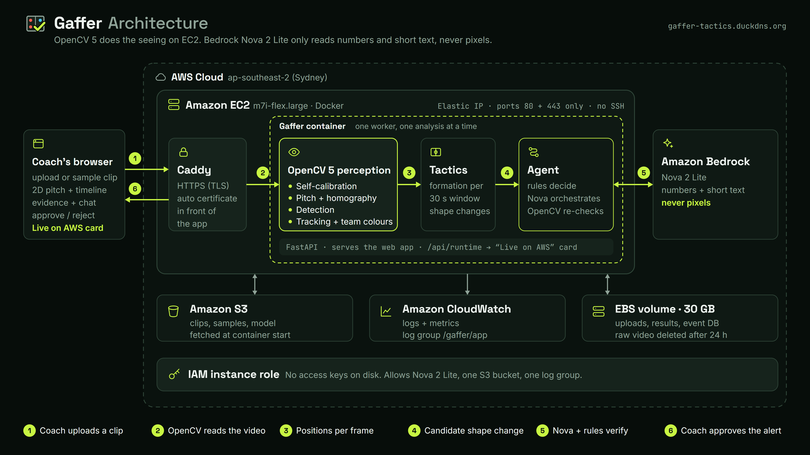
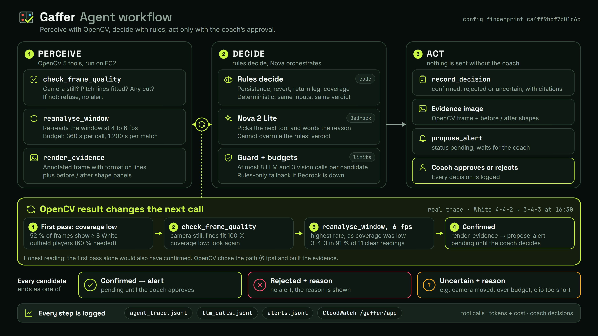

# Gaffer: technical report

OpenCV AI Competition 2026, powered by AWS. Author: Haider Sultan, FAST-NUCES, Pakistan. Status: 24 Oct 2026.

Every number here comes from a file named next to it (`outputs/…`, `RECORD.md`, `docs/…`) and is cross-checked in [`FINAL_AUDIT.md`](FINAL_AUDIT.md). Server timings were measured on the live instance on 24 Oct (sections 4.5, 6, 7.6). Where a number was measured on a busy laptop, the text says so.

Contents: [1 Problem](#1-the-problem) · [2 Users](#2-the-users) · [3 Architecture](#3-architecture) · [4 OpenCV 5 implementation](#4-opencv-5-implementation) · [5 The self-verifying agent](#5-the-self-verifying-agent) · [Agentic Vision Award evidence](#agentic-vision-award-evidence) · [6 AWS deployment](#6-aws-deployment) · [7 Evaluation](#7-evaluation) · [8 What did not work](#8-what-we-tried-that-did-not-work) · [Honest limitations](#honest-limitations) · [Responsible use](#responsible-use) · [Reproduce](#reproduce)

## 1. The problem

A football coach decides with what they can see from the touchline. Professional clubs buy tactical analysis (tracking data, analysts, broadcast graphics) that costs thousands per season. A grassroots or university coach has a phone, perhaps a drone and a volunteer filming from a high spot, and no analyst. The question that matters most in a match is simple and hard to answer in real time: **has the other team just changed shape, and what does that mean for us?**

Gaffer's answer is a tactical analyst that watches the match video, reads each team's formation over time, flags the moment a team switches shape, and **verifies the flag before it speaks**. The verification is the point: a formation read from video is noisy (players hidden by a free kick, a camera that wobbles, a shadow read as a person), and an assistant that cries wolf on every wobble is worse than none. Gaffer sends OpenCV back to look again before it raises an alert, and says "uncertain" when the footage does not support an answer.

## 2. The users

**Grassroots and university coaches** with an elevated camera (a drone or a high fixed position) and no analyst. They need: an alert only when it is real, evidence they can see in two seconds (an annotated frame and a before/after shape), a plain-words reason, and control (they approve or reject every alert). They do not need a dashboard of 200 metrics. The web app is built for that: one desk with the video beside a 2D pitch, a shape timeline, and one alert card at a time. The live demo uses an amateur university match (TeamTrack, MIT licence), which is the kind of footage a grassroots coach can produce.

## 3. Architecture

Source: [`architecture.mmd`](architecture.mmd). Three design rules hold the system together:

1. **A frozen data contract.** `match_state.json` (per-frame positions, teams, quality) and `tactical_timeline.json` are versioned (v1.0, [`DATA_CONTRACT.md`](DATA_CONTRACT.md)). The synthetic generator and the real-video pipeline emit the identical schema, so the tactics engine and the agent were built and measured on synthetic matches with exact ground truth before any real video was processed.
2. **The agentic vision loop.** The tactics engine only produces *candidates*. The agent decides what happens to each: check the camera, look again at a higher rate, then confirm, reject or mark uncertain. An OpenCV result must change what the agent does next, and the trace shows it.
3. **Query, never stuff.** The LLM never receives pixels or raw coordinates. Tools return small JSON (under 1 KB per result); decisions must cite tool results by reference.

Code layout: `src/gaffer/perception/` (OpenCV pipeline), `tactics/` (formations, change detector, metrics), `agent/` (tools, rules, loop, explanations, report, posture), `api/` (FastAPI backend), `aws/` (S3 asset fetch), `web/` (React frontend), `deploy/` (Docker, EC2 scripts).

## 4. OpenCV 5 implementation

OpenCV 5.0.0 (`opencv-contrib-python==5.0.0.93`, pinned in `requirements.lock`) is the inference engine and the geometry engine. No PyTorch, no Ultralytics. The version is printed by `scripts/smoke_test_opencv.py` and reported by `/api/health`.

### 4.1 Perception (video → `match_state.json`)

| Step | What happens | OpenCV 5 functions |
|---|---|---|
| Pitch and homography | Painted lines are isolated with a top-hat line mask, thinned to centre lines, snapped to the markings of an IFAB pitch model, and a homography maps pixels to metres. On an upload the four pitch corners are found automatically and shown to the coach for a yes/no. | `cv2.morphologyEx` (top-hat), `cv2.ximgproc.thinning`, `cv2.fitLine`, `cv2.findHomography`, `cv2.perspectiveTransform` |
| Drone drift | A hovering drone moves. Every sampled frame is re-aligned to the calibration frame on the pitch-line image; ORB + RANSAC is the fallback when the line image does not correlate. | `cv2.phaseCorrelate`, `cv2.findTransformECC`, `cv2.ORB_create`, `cv2.estimateAffinePartial2D` |
| Detection | Drone view: a classical detector (colour-based foreground against a per-video grass model, blob size from the homography). Side view: YOLOX-S ONNX through `cv2.dnn` on tiles. | `cv2.dnn.readNet`, `blobFromImage`, `cv2.connectedComponentsWithStats`, `cv2.morphologyEx` |
| Tracking | ByteTrack (`supervision`, MIT) on the detections. | |
| Team colours | Torso colour in Lab, two team clusters plus referee and keeper clusters, per-track vote. | `cv2.kmeans`, `cv2.cvtColor` |
| Positions | Foot points projected to pitch metres; off-pitch people dropped; attacking direction inferred from the goalkeepers. | `cv2.perspectiveTransform` |
| Fisheye (side camera, experimental) | Four distortion models compared; the side view is near-rectilinear, so two sectioned homographies are used. | `cv2.fisheye.*`, `cv2.findHomography` |

Timings per stage are printed for every run. Measured numbers and accuracy are in [§7](#7-evaluation).

### 4.2 Per-video self-calibration (23 Oct)

The first detector was tuned on one overcast TeamTrack day. On an unseen ground (Zenodo drone clip: artificial turf, low sun, player shadows as long as the players, light-pole shadows across the pitch, staff and spare balls behind the lines) it produced 63 detections per frame for 25 annotated people (precision 0.40) and gave a team to only 41 % of the players. `perception/selfcal.py` learns the calibration from each video, with OpenCV only, and every part is a config switch:

- **grass model** from the first frame's pitch pixels (`cv2.calcHist` hue peak, robust percentiles); **shadows** (darker, cyan-shifted, saturated turf) count as background and thin elongated blobs are rejected;
- **expected player size** from the homography at each blob, and a working resolution of 14.7 px/m whatever the drone height;
- **static objects** (detections that recur at the same pitch point in 60 % of frames) are dropped;
- **pitch mask**: detections beyond 1.5 m outside the confirmed pitch are dropped;
- **team colour from the player's own foreground pixels**, and a **team gate** set from this video's colour distribution.

Settings were chosen only on the TeamTrack dev clip and the first 10 s of the Zenodo clip; the test part (10–26.7 s) was unseen. Results are in [§7.3](#73-an-unseen-ground-zenodo). **Ablation, with a caveat.** The first leave-one-out numbers (without shadows F1 0.709; without crop foreground strict coverage 58 / 39 % home / away; without the adaptive gate 5 / 61 %; pitch mask, local scale, static objects and grass model about no change) were taken with the `crop_exclude_lines` switch **on** (`outputs/eval_zenodo_no_*.json`); the final config has it **off** (on the Zenodo tuning third it lowered team accuracy from 0.96 to 0.85). A later set of runs with the final config exists (`outputs/eval_zenodo_fno_*.json`, 23 Oct 16:11–16:23, each file records `crop_exclude_lines: false`); on the unseen test part, strict formation coverage home / away (final = 96 % / 76 %) is: without shadows 0 % / 40 % (F1 0.709 instead of 0.855), without crop foreground 33 % / 51 %, without the adaptive gate 8 % / 73 %, without local scale 92 % / 79 %, without static objects 91 % / 79 %, without the grass model or the pitch mask 96 % / 76 % (no change on this clip). So the two sets agree on what matters (shadows, crop foreground, the adaptive gate) and differ in the size of the loss; the final-config set is the one to quote. One 30 s clip: it shows which parts mattered on that ground, not that every part matters everywhere.

### 4.3 The tactics engine

Per team and per 30 s trailing window (step 5 s), the engine assigns the visible outfield players to each template formation (4-4-2, 4-3-3, 4-2-3-1, 3-5-2, 3-4-3, 5-3-2) with the Hungarian algorithm and an anisotropic template fit, turns the residuals into a softmax confidence, and labels the window `uncertain` rather than guessing when confidence is below 0.45 or fewer than 8 outfield players are visible. A hysteresis detector turns a changed label that holds for 20 s into a **candidate shape change**. 3-5-2 and 5-3-2 are one family (wing-backs drop into a back five without the ball). Each window also carries metrics (defensive line, compactness, width, centroid). All thresholds are in `config.yaml`. The engine is **frozen** since Phase 1 (apart from two options that are off), which is why the synthetic numbers in §7.1 can be compared with later work.

### 4.4 Evidence

For a confirmed change, OpenCV draws the frame with every player and the team's formation lines projected through that frame's own homography, plus before/after panels of the typical window of each shape (the "before" window is chosen with at most 25 % of the team's positions inside its own penalty area, so a set piece is not shown as the usual shape). The image is a JPEG ≤ 1 MB.

### 4.5 Speed of the 4K re-anchoring (A4, 24 Oct)

**Why it was slow.** The unseen-ground run in the generalisation session reported geometry (the per-frame re-anchoring) as 421 s of about 500 s for 30 s of 4K video (`outputs/eval_zenodo_final.json`). That run was made while the laptop was busy; re-measured on an idle laptop the same baseline takes 110 s of geometry in a 134 s run, 4.39 s per video second (`outputs/eval_zenodo_a4_before.json`). The cause, profiled on 24 frames of the Zenodo clip (`outputs/a4_geo_bench.json`): `cv2.findTransformECC` at the working scale (0.25) did not reach the 0.6 correlation floor on 21 of 24 frames (low sun and shadows make the line image weak), so each of those frames paid for a failed ECC and then the ORB fallback on the full 4K frame: 0.89 s per frame, against 0.09 s on TeamTrack, where ECC succeeds.

**The change (one config switch, `drift.coarse_to_fine`).** ECC first runs on a copy of the line image at half the working scale (a wider basin and a quarter of the pixels); its warp, rescaled, becomes the start of the normal ECC. If the coarse pass fails or correlates below the floor, the old phase-correlation start is used. Plain downscaling was also tried and rejected: at scale 0.125 it was fast (0.035 s per frame) but the line error rose from 0.075 m to 0.121 m median.

| | before | after (`coarse_to_fine` on) | source |
|---|---|---|---|
| Zenodo, 24 frames: s per frame; ORB fallbacks | 0.888; 21 | 0.097; 0 | `outputs/a4_geo_bench_c2f.json` |
| Zenodo, 24 frames: line error median (re-anchor error) | 0.075 m | 0.079 m | same |
| TeamTrack dev clip, 24 frames: s per frame; line error | 0.089; 0.087 m | 0.089; 0.087 m (identical alignment) | same |
| Zenodo unseen test, P / R / F1 at 1 m | 0.7648 / 0.9702 / 0.8553 | 0.7616 / 0.9702 / 0.8533 | `outputs/eval_zenodo_a4_before.json`, `…_a4_after.json` |
| Zenodo unseen test, team accuracy | 98.25 % | 98.1 % | same |
| Zenodo whole run: geometry s; s per video s | 109.9; 4.39 | 18.2; 1.29 | same |
| TeamTrack eval (1560–1800 s): F1 / team accuracy / IDF1 | 0.9185 / 98.36 % / 0.526 | identical | `outputs/eval_tracking_top_a4_before.json`, `…_a4_after.json` |
| TeamTrack eval: formation agreement White / Blue | 100 % / 90.0 % | identical | `outputs/eval_real_a4_before.json`, `…_a4_after.json` |
| TeamTrack eval: s per video s | 1.269 | 1.227 | same |
| TeamTrack eval2 (1260–1530 s, re-run 24 Oct with the switch on): F1 / team accuracy / IDF1 | 0.930 / 98.8 % / 0.457 | identical (0.930 / 98.8 % / 0.457) | `outputs/eval_second_set_tracking_top_final.json`, `…_c2f.json` |
| TeamTrack eval2: formation agreement White / Blue | 93.5 % / 88.1 % | 93.6 % / 88.1 % (one more window both-confident, 47 of 48) | `outputs/eval_second_set_real_final.json`, `…_c2f.json` |
| TeamTrack eval2: candidates (pipeline), matched to the 2 oracle changes | 6, 2 | 4, 2 (the two spurious out-and-back White candidates are gone) | same |
| Demo window as one 4K upload (rules arm, 23 → 24 Oct): s per video s; geometry s; wall s | 3.06; 559.6; 2,738.6 | 2.75; 424.1; 2,703.1 | `outputs/upload_check/demo_final_full/upload_check.json`, `…/demo_c2f_full/…` |

**Decision: ON.** The pre-set rule was "on only if accuracy is the same within noise and time drops clearly". On the unseen ground F1 moves by 0.002 and the whole run is 3.4 times faster; on TeamTrack `eval` the output is identical. **Re-checked on 24 Oct (morning) on the two things the overnight run had not covered, with the switch on:** TeamTrack `eval2` is unchanged to the third decimal (the formation read is one window better for White, and two spurious candidates disappear), and the demo's 6 minutes uploaded as one file still give the same 8 candidates, with White's 4-4-2 → 3-4-3 at 16:30 and Blue's change **both confirmed with the same windows held** (73 % of 11 and 75 % of 12). The speed-up appears only where ECC used to fail (the Zenodo-type footage): on this TeamTrack 4K upload geometry went from 559.6 s to 424.1 s and the run from 3.06 to 2.75 s per video second, and the whole upload barely moved (2,738.6 s to 2,703.1 s) because the agent's re-analysis budget (about 1,400 s) dominates. Neither upload was a controlled benchmark: the 23 Oct run was on a loaded laptop and the 24 Oct run on a laptop with an editor and a browser open. It has been deployed since 24 Oct: the 6-minute 4K upload on EC2 (section 6) spent 148.1 s of its 403.2 s detection stage in geometry and ran at 1.13 s per video second in total, against 1.29 on 22 Oct (a build with neither this change nor the 23 Oct self-calibration, so that comparison is not an A/B of this switch).

## 5. The self-verifying agent

**Rules decide, the LLM orchestrates and explains.** For each candidate, the agent (Amazon Nova 2 Lite on Bedrock) runs this loop (diagram: [`agent_workflow.png`](agent_workflow.png), design: [`AGENT_DESIGN.md`](AGENT_DESIGN.md)):

1. Read the candidate card (team, time, from → to, first-pass numbers).
2. `check_frame_quality` (OpenCV): are the pitch lines fitted in at least 90 % of sampled frames, is the camera still (shift ≤ 25 px/s, zoom change ≤ 3 %), any cut? A moving camera ends the candidate: **uncertain, no alert**.
3. If coverage before the change is low or the footage is too short: `reanalyse_window` (OpenCV re-runs the whole perception pipeline on that window at a higher rate, 4–6 fps, with a time budget of 360 s per call and 1,200 s per match).
4. Deterministic rules (`agent/verify.py`, frozen, fingerprint `ca4ff9bbf7b01c6c`) read the numbers: does the new shape hold in at least 60 % of the confident windows after detection (persistence), did the team go back to the old shape (revert), is this a return leg of an earlier change?
5. `record_decision` (confirmed / rejected / uncertain, with citations to tool results), then for a confirmation `render_evidence` and `propose_alert`, which **waits for the coach**.

A guard around the loop enforces the protocol: no alert before verification, no confirmation against the rules' verdict, at most 8 LLM calls and 3 vision calls per candidate, per-match caps (150 calls, 400 k tokens, $0.50), a rate limiter below the account quota, and a rules-only fallback if Bedrock is unreachable. The model's own text is **explanation only**: a separate step asks for one or two plain sentences from the code's facts, checks them (names the cause, no contradiction of the decision, numbers only from the facts, no ball / possession / pressing claims) and falls back to a code-written template when the check fails.

**What the evidence says, honestly.** The agent helps by a large margin on false alerts (§7.1, 34 → 9). The decisions come from the rules: Nova's decisions were identical to the rules arm's on all 68 candidates. The LLM adds orchestration (which window, which rate) and wording, not better verdicts. We say this plainly because the Agentic Vision criterion is that **OpenCV output changes what the agent does next**, and that is true in the design and in the traces below; it is not the same as "the LLM is smart".

## Agentic Vision Award evidence

Four things the award asks for, each with its source.

### A. The workflow diagram

Source: [`AGENT_DESIGN.md`](AGENT_DESIGN.md) §10 (Mermaid), rendered to [`agent_workflow.png`](agent_workflow.png).

### B. Traces where an OpenCV 5 result changes a later tool call or decision

[`AGENT_TRACE_EXAMPLES.md`](AGENT_TRACE_EXAMPLES.md) copies three real traces and states what each shows:

- **(a) White 4-4-2 → 3-4-3 at 16:30.** First pass: only 52 % of the frames before the change show at least 8 White outfield players. `check_frame_quality` (OpenCV, 11.3 s): camera still, lines fit 100 %. Because coverage is low the agent calls `reanalyse_window` at the **highest** rate (6 fps rather than 4): **the OpenCV result chose the next call's arguments**. Result: 3-4-3 in 91 % of 11 clear readings, no return → confirmed → `render_evidence` → pending alert. *Honest reading:* the first pass alone would also have confirmed; OpenCV decided the path and produced the evidence, not the verdict.
- **(b) Blue 3-5-2 → 4-4-2 at 26:35.** First pass says "reverted after 55 s". The second look at 4 and 6 fps finds **no revert**: the new shape holds in only 17 % of 12 readings → still rejected, with a different reason. *OpenCV contradicted the first pass; the decision stayed, the reason changed.*
- **(c) Simulated pan and zoom on real frames.** The same drone frames re-encoded as a sliding, zooming crop. `check_frame_quality` measures 190 px/s of camera motion, 30 % zoom change and lines fitted in 33 % of frames → **refuse**: no re-analysis, decision **uncertain** where the first pass alone says reject. This is the one case where an OpenCV result changes both the next call and the decision on real frames; the camera motion is synthetic.

We do not claim more: on 14 real candidates the decision always equalled the first pass alone, and `AGENT_DESIGN.md` §14 says so. On synthetic matches the rules' second look changes decisions systematically (that is where the 34 → 9 comes from).

### C. Evaluation of task success

Task: raise an alert on a real tactical shape change and not on noise. 10 held-out synthetic matches (seeds 110–119; 38 real shape changes; run once with frozen rules, `outputs/eval_agent_final.json`):

| arm | real changes alerted | false alerts | uncertain | rejected real | mean alert delay |
|---|---|---|---|---|---|
| one-shot (alert every candidate) | 34 / 38 | 34 | 0 % | 0 | 42 s |
| rules only (no LLM) | 32 / 38 | 9 | 2 % (1 / 68) | 2 | 105 s |
| agent (Nova 2 Lite) | 32 / 38 | 9 | 2 % (1 / 68) | 2 | 105 s |

The pre-set bar (false alerts ≤ 16 **and** ≥ 30 / 38, uncertain ≤ 30 %, delay ≤ 120 s) was fixed before the run and is met. Cost: 195 LLM calls (2.9 per candidate), $0.21 in total, $0.021 per match, no throttling. 68 / 68 decisions equal the rules arm (0 guard blocks, 0 invalid calls, 0 fallbacks). "The set is agent-untouched, not unseen": the tactics engine's output on these seeds had been seen in an earlier phase (`AGENT_DESIGN.md` §8).

### D. Failure handling, observability and human control

| Aspect | What exists | Source |
|---|---|---|
| **Failure handling** | Throttling: backoff plus a client-side limiter at 18 requests/min. Model access error: Nova Micro fallback. Malformed tool call: error result; two in a row → rules fallback for that candidate. Bedrock unreachable or caps spent: the remaining candidates go to the rules arm (`decided_by: rules (llm unavailable)`). Camera moved or cut: refuse, no alert. Clip too short for the look-ahead: uncertain. OpenCV over budget: refusal with the maximum window that would fit. Looping: the third identical call ends the candidate. A text explanation that fails its check: code template. | `AGENT_DESIGN.md` §6; `config.yaml` `agent.limits` |
| **Observability** | `outputs/llm_calls.jsonl` (model, tokens, latency, cost per call), `outputs/agent_trace.jsonl` (every tool call with arguments, a result summary and duration; a `prev_ref` chain from one result to the next), `outputs/alerts.jsonl` (every alert and the coach's decision, append-only). On EC2 all three, plus the chat, posture and per-analysis traces, are shipped to CloudWatch log group `/gaffer/app` (7 streams), with metrics `Gaffer/AnalysesCompleted` and `Gaffer/BedrockCalls`. The app shows the trace of each candidate. | `AGENT_DESIGN.md` §7; `deploy/DEPLOY_AWS.md`; `RECORD.md` 22 Oct |
| **Human control** | `propose_alert` creates a **pending** alert. The coach approves or rejects it in the UI (or `py -m gaffer.agent.alerts --approve/--reject`); the decision is appended with a note. Uncertain and rejected candidates raise no alert, and the reason is shown. Coach decisions never change the verification record. | `src/gaffer/agent/alerts.py` |

## 6. AWS deployment

Live: **https://gaffer-tactics.duckdns.org/** (Let's Encrypt certificate; the old plain-http link http://13.210.196.109/ still works), Sydney (ap-southeast-2), first deployed 22 Oct, current build and HTTPS deployed 24 Oct ([`deploy/DEPLOY_AWS.md`](../deploy/DEPLOY_AWS.md)).

- **EC2** `m7i-flex.large` (2 vCPU Intel, 8 GiB): two Docker containers: Caddy (TLS with an automatic Let's Encrypt certificate, ports 80 and 443) in front of the app (FastAPI, the single analysis worker with OpenCV 5, the built frontend; no host port). 30 GB gp3 volume, Elastic IP, DuckDNS name, security group with ports 80 and 443 only (no SSH).
- **Bedrock**: Nova 2 Lite through the global inference profile `global.amazon.nova-2-lite-v1:0` (Nova Micro `apac.amazon.nova-micro-v1:0` as fallback), called with the **instance role** (`credentials: iam-role` in `/api/health`). Daily caps for every Bedrock call the API makes: 300 calls and $1.00 per UTC day (`config.yaml` `api.bedrock_daily`).
- **S3** bucket `gaffer-demo-221039325928` (private, SSE-S3): 14 assets (replay clips, sample clip, model, 593.6 MB on 22 Oct; the TeamTrack sample has since shrunk by 186 MB) fetched at container start, plus source tarballs for redeploys.
- **CloudWatch**: log group `/gaffer/app` (14 days), two metric filters.
- **IAM**: role `gaffer-ec2-role` (Systems Manager core + an inline policy for Nova 2 Lite / Nova Micro, the one bucket and the one log group); no access keys on the instance or in the image. **Systems Manager** Session Manager / Run Command for deploys.
- **Cost**: about $0.13 per hour, $3.10 per day while running, about $0.22 per day stopped (`deploy/DEPLOY_AWS.md`).

What was observed on the live server on 22 Oct: health from the internet 200 in 0.57 s; the recorded-match replay end to end (12 clips, 11 seeks, 11 handoffs, reveal at 1085 s); the 30 s 1080p sample in **12.7 s** wall; a 6-minute 4K upload in **1,888 s** (detection 464 s, agent 1,412 s of which 1,208 s were the OpenCV re-analysis budget); a grounded Bedrock chat answer in 5.4 s; the approved alert and its event kept across an instance reboot; all seven log streams and both metrics arriving (`RECORD.md` 22 Oct, N6a). 

**Observed on 24 Oct, after the HTTPS redeploy of the current build** (`outputs/sample_timing_ec2.json`, `outputs/ec2_upload_6min_24oct.json`, CloudWatch; the same `m7i-flex.large`; clients went through the public HTTPS URL and the normal upload path, Nova 2 Lite on Bedrock):

| | 22 Oct build | 24 Oct build (self-calibration + A4 + HTTPS) |
|---|---|---|
| Redeploy (`deploy.sh`) | image build 53 s, healthy 64 s after the start | build 15 s (Docker cache), app up 25 s, certificate issued and https answering 30 s after the start |
| TeamTrack 30 s 1080p sample, end to end | analysis 12.7 s wall (server log) | **23.5 s** (pitch check 3.4 s + analysis 20.2 s; 0.55 s per video second; server log 19.1 s wall) |
| Zenodo 30 s 1080p sample, end to end | not offered yet | **23.0 s** (pitch check 2.9 s + analysis 20.1 s; 0.56 s per video second; server log 18.8 s wall) |
| 6-min 4K upload (the demo's 12 clips joined, 360.4 s) | 1,892.9 s wall (server log): detection 464 s, agent 1,412 s | **1,679.9 s wall** (28.0 min): detection stage 403.2 s (1.13 s per video second), agent stage 1,272.2 s of which OpenCV re-analysis 1,064.9 s |
| Result of the 6-min upload | 8 candidates: 1 confirmed, 4 rejected, 3 uncertain | 8 candidates: **2 confirmed** (White 4-2-3-1 → 3-4-3 at 1:30, held in 83 % of 12 windows; Blue 4-2-3-1 → 4-4-2 at 1:25, 75 % of 12), 3 rejected, 3 uncertain; the same 8 as on the laptop (section 7.5) |
| Bedrock for the 6-min upload | 47 calls, $0.049 | 49 calls, $0.052 (+ 2 posture calls, $0.0031) |
| CloudWatch | 7 streams, 2 metrics | `caddy` stream new; `app`, `llm_calls`, `analysis_trace` streams written; `BedrockCalls` 51 and `AnalysesCompleted` 3 for 24 Oct, equal to the server's own counter (51 calls, $0.0538) |

The samples take longer than on 22 Oct (12.7 s to 19.1 s of server-side analysis for the TeamTrack clip) most likely because the 23 Oct self-calibration adds a first-frame grass model, local scale and a static-object pass (not isolated on EC2); the 6-minute run is 11 % shorter in wall time. The Elastic IP, S3 and IAM role are unchanged; the security group gained port 443. We did not pursue the Graviton instance idea: the Free plan refused `t4g.large` ("not eligible for Free Tier"), so the largest eligible type is the Intel `m7i-flex.large`.

## 7. Evaluation

State plainly where each result comes from: **synthetic** matches (exact ground truth, the engine and agent), **TeamTrack** (one real match, drone view, first half: perception and formations against annotations), **Zenodo** (one unseen drone clip), and a **720p** copy of the demo window.

### 7.1 Tactics engine and agent on synthetic matches

Held-out seeds 110–119 (10 matches of 90 minutes; `outputs/eval_synthetic_heldout2.json`, first run 15 Oct, engine unchanged since Phase 1):

| | value |
|---|---|
| Formation accuracy per 30 s window, when confident | 97.7 % overall (full view 97.6 %, broadcast-window view 98.0 %); strict (uncertain counts as wrong) 77.4 % |
| Shape changes (38 true, ±90 s) | 34 hits, 4 misses (3 found late after low visibility), **34 false positives**, mean delay 42 s (max 125 s); new formation right in 31 of 34 hits |
| False-positive causes | set piece 14, other 11 (18 of the 34 are 4-3-3 ↔ 4-2-3-1 flips, 16 of them in one seed), partial view 8, counter-attack 1 |
| Timeline JSON | max 14.0 KB, mean 6.3 KB |

The generator and the engine share one model of a formation, so the 97.7 % is an upper bound for real footage. The agent's effect on these candidates is in §5 (34 → 9 false alerts).

### 7.2 Real footage: TeamTrack, drone view

Evaluation windows: `eval` = match 1560–1800 s (8 clips), `eval2` = 1260–1530 s (9 clips; never tuned on, but **not independent** of `eval`: same match, cameras, teams and neighbouring minutes). The calibration (31 landmarks) and the team colours were chosen on a separate dev clip (1530–1560 s). Final settings after self-calibration (`outputs/eval_tracking_top_final.json`, `outputs/eval_second_set_tracking_top_final.json`, `outputs/eval_real_final.json`, `outputs/eval_second_set_real_final.json`):

| metric | eval (1560–1800 s) | eval2 (1260–1530 s) |
|---|---|---|
| Detection F1 at 1 m (raw) | 0.918 (P 0.872, R 0.970) | 0.930 |
| F1 with unannotated referees removed | 0.984 | 0.990 |
| Team accuracy (settled labels) | 98.4 % | 98.8 % |
| IDF1; ID switches per player-minute | 0.526; 1.80 | 0.457; 1.41 |
| Formation exact agreement with the ground-truth-position oracle, White / Blue | 100 % / 90.0 % | 93.5 % / 88.1 % |
| Candidates: oracle / pipeline | all 3 oracle changes matched, 5 pipeline candidates | all oracle changes matched, 6 pipeline candidates |

Calibration: held-out landmark error 0.11 m mean on the drone view (31 landmarks, `docs/DATA_NOTES.md`). Pitch auto-detect for uploads: 180 / 180 correct on 60 drone clips after a fix for a turf edge taken as a goal line (`outputs/eval_autodetect.json`; the fix was made on these clips, so this number is not held out; `FAILURE_LOG.md` 2026-10-17). The side camera (fixed fisheye-looking panorama) is experimental: detection F1 0.49 at 1 m raw (0.78 at 2 m), 3.4 s per frame, alerts capped at "uncertain".

### 7.3 An unseen ground (Zenodo)

Zenodo 10.5281/zenodo.14867795 (CC BY 4.0), 30 s, 4K, annotated people. Settings chosen on the TeamTrack dev clip and Zenodo 0–10 s; **unseen test = 10–26.7 s** (`outputs/eval_zenodo_before.json` → `outputs/eval_zenodo_final.json`):

| metric (1 m) | before self-calibration | after |
|---|---|---|
| Precision / recall / F1 | 0.396 / 0.999 / 0.567 | 0.765 / 0.970 / 0.855 |
| Detections per frame (25.0 annotated) | 63.1 | 31.7 |
| Players with a team label | 41 % | 95 % |
| Team accuracy | 81 % | 98 % |
| Frames with ≥ 8 correctly-teamed annotated outfield players, home / away (strict coverage) | 0 % / 10 % | 96 % / 76 % |

Still weak: about 6 false detections per frame remain (staff within 1 m of the touchline, painted-line junctions), and the auto-detected pitch has one corner 1.4 m off in the final run (1.74 m in the first run) against the corners implied by the annotations (the "every corner ≤ 1 m" rule fails there; `outputs/eval_zenodo_final.json`, `outputs/eval_zenodo_before.json`). This is one 30 s clip of one ground.

### 7.4 720p against 4K (one clip, TeamTrack train split, not held out)

Demo window 900–1260 s, default config, both calibration tiers off (`outputs/teamtrack_720p_check/report.json`, `docs/DATA_NOTES.md` §13):

| | 4K | 720p |
|---|---|---|
| Detection F1 at 1 m raw / referees removed | 0.928 / 0.978 | 0.928 / 0.958 |
| Team accuracy | 99.0 % | 98.5 % |
| IDF1 | 0.468 | 0.416 |
| Formation exact agreement, White / Blue | 91.7 % / 86.2 % | **74.1 %** / 82.8 % |
| White 16:30 change found | yes | yes |
| s of processing per video s (laptop) | 1.42 | 0.34 |

The raw F1 is equal only because 720p finds half as many unannotated referees; on players alone 720p is worse (recall 0.973 → 0.926). The demo's 720p copy is a downscale of the 4K file, not a native 720p camera.

### 7.5 Upload consistency (the demo's 6 minutes as one upload)

The same 6 minutes through the normal upload path (auto-detected corners, rules arm, laptop; `RECORD.md` 23 Oct): White's 4-4-2 → 3-4-3 at 16:30 is found and **confirmed** (read as 4-2-3-1 → 3-4-3, held in 73 % of 11 windows), Blue's 16:25 change is confirmed, 8 of the 9 demo candidates have a same-team, same-new-shape counterpart, and the other 6 candidates are left uncertain because the frozen 1,200 s re-analysis budget was spent on the first two. **Re-run on 24 Oct with `drift.coarse_to_fine` on** (`outputs/upload_check/demo_c2f_full/upload_check.json`): the same 8 candidates; the same two confirmed (White 4-2-3-1 → 3-4-3 at 1:30 of the upload, held in 73 % of 11 windows; Blue 4-2-3-1 → 4-4-2, 75 % of 12); one candidate that was left uncertain before (Blue 4-4-2 → 4-2-3-1, 2:30 into the upload) is now rejected on its own evidence (it reverted after 30 s), so 5 candidates are uncertain instead of 6; why that one decision moved was not investigated (the agent's rules and the tactics engine are unchanged, the re-analysis time was 1,434.5 s against 1,388.7 s before). 3.06 → 2.75 s per video second (section 4.5). Cause of the earlier mismatch (22 Oct, EC2): White defends a free kick in 15:45–16:30 with only 7.1–7.6 of 10 outfield players visible, and one 5 s window decides whether the 4-4-2 lasts the 20 s the engine needs (`FAILURE_LOG.md` 2026-10-23).

### 7.6 Sample clips end to end (laptop, no Bedrock)

`scripts/time_samples.py` against `scripts/serve_no_bedrock.py` (`outputs/sample_timing.json`; the first run, `outputs/sample_timing_run1.json`, overlapped other work on the laptop and was about 3 times slower, so the second run is the one quoted): the TeamTrack 1080p sample takes 20.6 s (pitch check 1.3 s + analysis 19.3 s) and the Zenodo 1080p sample 18.5 s (1.1 s + 17.3 s). Both clips measure 14.0 and 14.7 px per metre, above the low-resolution threshold. **The TeamTrack sample file was shrunk on 24 Oct** from 218.4 MB to 32.3 MB (same 1080p frames, H.264 CRF 16 through PyAV, `make_sample_clip.py --codec x264 --crf 16`) so the plain Download link is usable. It was accepted only after the analysis matched: same pitch (14.0 px per metre), White 4-4-2 and Blue 5-3-2, 0 candidates, visible players 10.2 / 10.5 against 10.1 / 10.5, median position difference to the old file 0.03 m. A CRF 23 copy (8.6 MB) was **rejected**: Blue read as 4-2-3-1 and referee-labelled detections fell from 180 to 75; CRF 12 (63.2 MB) was no closer than CRF 16. Even at CRF 16 referee-labelled detections are 124 against 180 (the old encoding kept more of the staff blobs); formations and candidates are unchanged (`scripts/compare_sample_clips.py`, `outputs/sample_clip_reencode.json`). The timings above were measured with the old TeamTrack file; a re-timing on 24 Oct (morning) with the new file ran on a busy laptop and took 70.3 s, but the unchanged Zenodo sample took 64.1 s in the same run, so that run measures the laptop, not the file (`outputs/sample_timing_busy_24oct_morning.json`). **On EC2 (24 Oct, through the public HTTPS URL):** TeamTrack sample 23.5 s, Zenodo sample 23.0 s end to end (`outputs/sample_timing_ec2.json`, section 6).

## 8. What we tried that did not work

All are in [`FAILURE_LOG.md`](FAILURE_LOG.md) with the evidence; the main ones:

- **Pretrained YOLOX on the drone view.** At 4K the players are small: recall 0.06 tiled, 0.54 with 2× upscaled tiles at 18 s per frame. Rejected for a classical detector (F1 0.906 on the first eval; `outputs/compare_detectors_top.json`). YOLOX stays the side-view detector.
- **Calibration tiers (an OpenCV health check, then a numeric-only Nova proposal).** Built, mocked-tested, measured on a 720p copy, and left **off**. Tier 1 (turn `local_scale` off below 14.7 px/m) made the TeamTrack check worse: detections per frame 21.8 → 12.8, White outfield points 8.3 → 2.6, team-labelled share 0.86 → 0.77. Tier 2 never triggered (the default pass was healthy). One real Nova call was made earlier; its reason called 0.75 "lower than 0.6", which is false, and the rerun was stopped at the time box. The earlier "69 % duplicate detections" problem came from a **generated 7.4 px/m clip**, not from real 720p footage (the real 720p copy at 9.3 px/m measured 5.9 %).
- **Metric check on 4-3-3 ↔ 4-2-3-1 candidates (Task A).** Cross-validated: false alerts 23 → 19, real changes 67 → 66; the pre-set criterion (−5 false alerts) was not met → off.
- **Letting a return leg be rejected only if persistence fails (the return-leg experiment).** Alerted real changes 67 → 67 but false alerts 23 → 48 → off. The rule still misses a real Blue change (see limitations).
- **4-3-3 = 4-2-3-1 as one family for change detection.** False positives 34 → 16 but hits 34 → 28 (all six lost are real switches) → off.
- **A line-drop event.** 1.70 false alarms per match on seeds 110–119, none on real clips → off.
- **A frame-by-frame LLM.** Not tried: the cost and latency of reading pixels is exactly what rule 3 avoids.

## Honest limitations

1. **One real match, first half.** All real-footage numbers come from one TeamTrack match (drone view). `eval` and `eval2` are neighbouring minutes of it. The 98–99 % team accuracy and 0.92–0.93 F1 do not say how Gaffer behaves on another club's kit and ground.
2. **Zenodo is one 30 s clip of one other ground.** Self-calibration helped a lot there, but it is a single clip, settings were chosen on its first third, and one auto-detected pitch corner is 1.4–1.7 m off.
3. **The demo window (900–1260 s) was chosen with the oracle.** It was picked because the ground-truth positions show the half's two lasting changes there. The confirmed 16:30 alert is a demonstration, not a random sample. No candidate is confirmed in the other real windows.
4. **The LLM adds nothing to the decisions.** 68 / 68 decisions equal the rules arm. The agent's value is orchestration, evidence and wording, and the false-alert reduction (34 → 9) comes from the deterministic rules' second look.
5. **A missed change.** Blue's 4-4-2 → 4-2-3-1 at 18:50 is real (it holds 220 s in the ground-truth positions) but is rejected by the return-leg rule because it reverses Blue's 18:00 change, although the 6 fps second look saw 4-2-3-1 in 100 % of 12 readings. The tested fix adds 25 false alerts on synthetic data, so it stays off.
6. **A fresh upload reads White's shape before 16:30 as 4-2-3-1, not 4-4-2.** White defends a free kick; with seven visible outfield players the template fit is ambiguous. The change is still found and confirmed, but "from" is wrong. And in the 6-minute upload, 6 of 9 candidates end up **uncertain** because the 1,200 s OpenCV budget is spent on the first two.
7. **Resolution.** Gaffer is tested mainly on 4K drone video. 720p is less reliable (White's formation agreement 91.7 % → 74.1 % on one clip). Generated low-resolution clips (7.4 px/m) show duplicate detections; real 720p footage did not.
8. **Panning or zooming cameras and broadcast footage are not supported** and are refused by design. A fixed side camera is experimental: its alerts are capped at "uncertain".
9. **No ball on the drone view**, so no possession, pressing or ball-aware set-piece logic.
10. **Cost of generalisation.** After self-calibration ID switches are about 10 % higher (1.61 → 1.80 and 1.31 → 1.41 per player-minute) and processing is 1.17 s per video second instead of 0.99 on the dev clip (idle laptop). With the A4 change (§4.5) the Zenodo-type footage runs at 1.29 s per video second on the idle laptop (4.39 before); TeamTrack is 1.23 (1.27 before) on its eval window.
11. **Slow on a small instance.** The Free plan allows no Graviton and no larger Intel type than `m7i-flex.large`; a 6-minute 4K upload took 31.5 minutes on 22 Oct and 28.0 minutes on 24 Oct (1,679.9 s of server wall time). Uploads are limited to 6 minutes.
12. **Posture and role advice are advisory and conservative.** The posture read often returns "unclear" (the before-window evidence is weak), and role advice is a two-rule heuristic, not a calibrated model.
13. **Chat.** One live grounding failure was found and the guard worked (the safe answer was shown); the fix was tested with a fake model only (`FAILURE_LOG.md` 2026-10-22).

Failure cases with images: [`FAILURE_LOG.md`](FAILURE_LOG.md); images in `outputs/failures/` (for example `2026-10-23_unseen_ground_before.png` and `…_after.png`, `2026-10-17_autodetect_turf_edge_before_after.jpg`, `2026-10-10_set_piece_false_candidate.png`, `2026-10-17_evidence_before_panel_set_piece.jpg`).

## Responsible use

- **No faces, no identities.** Players are anonymous dots and boxes; the system has no face model and no jersey-number reader. Evidence images are top-down frames at drone scale. Youth footage policy: Gaffer is not used on identifiable minors; a YouTube U13 clip considered for a stress test was looked at by eye only (a local copy is gitignored; frames are never committed or shown) and is not part of any result (`DATA_SOURCES.md`, `FAILURE_LOG.md` 2026-10-15).
- **Only licensed data, with credit.** TeamTrack (MIT, Scott et al., 2024) and the Zenodo preview clip (CC BY 4.0, Synowiec, Nowak, Kamola, DOI 10.5281/zenodo.14867795). No broadcast footage, no copyrighted music. Every source is in `DATA_SOURCES.md`; no AGPL code and no Ultralytics weights.
- **What goes to Bedrock.** Numbers and short text only, never pixels: candidate cards and tool results (formation labels, metric values, coverage, timestamps), the code's reason strings, and, for the chat, the visitor's typed question and the stored results. Chat questions are logged as typed (no names, no IP addresses; visitors are a random cookie id). Uploaded videos stay on the server; they are never sent to a model.
- **Cost caps and budgets.** Bedrock: 300 calls and $1.00 per UTC day for the whole API, $0.30 per analysis, per-match agent caps (150 calls, $0.50), a chat cap of 20 questions per visitor per day. AWS: budget `gaffer-budget` with alerts; the plan is to raise it to $40 per month for the judging period (`deploy/DEPLOY_AWS.md`). The Free plan closes the account when credits reach $0, so credits are watched too.
- **The coach approves every alert.** `propose_alert` only creates a pending alert; nothing is sent or acted on automatically. Role-level advice is conditional ("consider…"), names no player and never suggests an automatic substitution.
- **"Uncertain" instead of guessing.** A moving camera, too little footage, an exhausted budget, a side camera or weak evidence all end in `uncertain` with the reason shown. The formation engine itself labels a window `uncertain` below 0.45 confidence. Explanations and the chat are checked against the stored results and replaced by a safe answer when they are not grounded.

## Reproduce

Commands: [`README.md`](../README.md) ("Build, test, deploy"). Footage and weights are not in the repo (licences and size); `scripts/download_teamtrack.py` restores the TeamTrack files with a size and SHA-256 check. The synthetic matches regenerate from seed 42 (`scripts/make_synthetic_match.py`). Agent evaluation: `scripts/eval_agent.py --set final` re-scores from the stored run. Pinned dependencies: `requirements.lock`; `pytest` mocks the LLM and never calls Bedrock.
