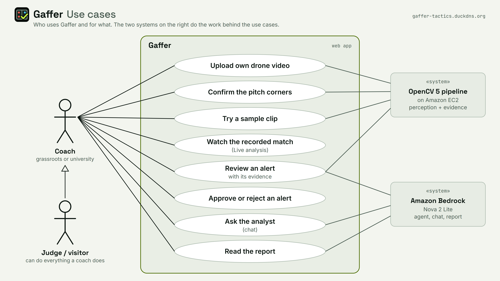
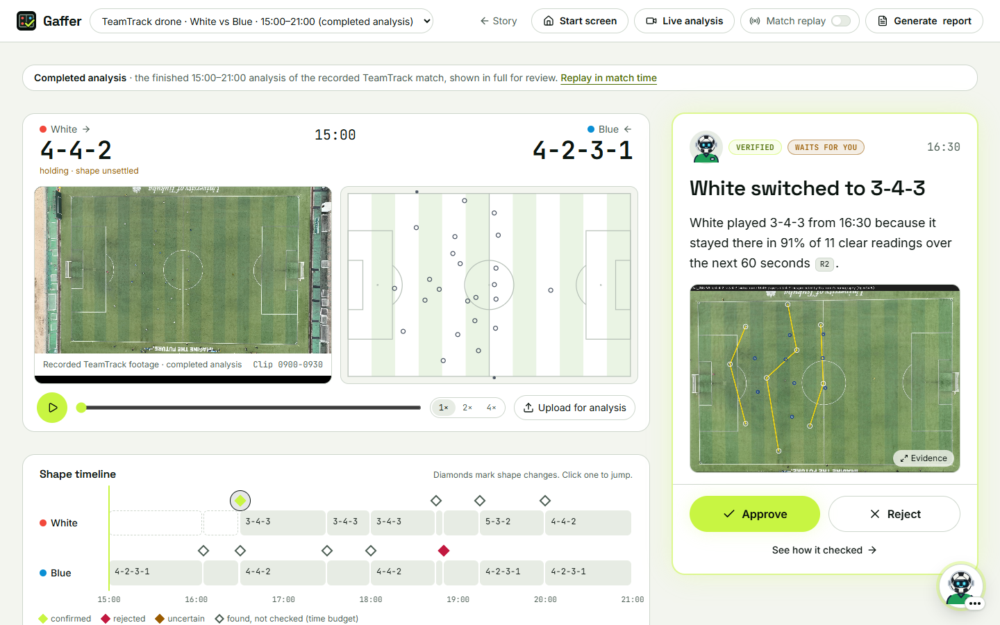
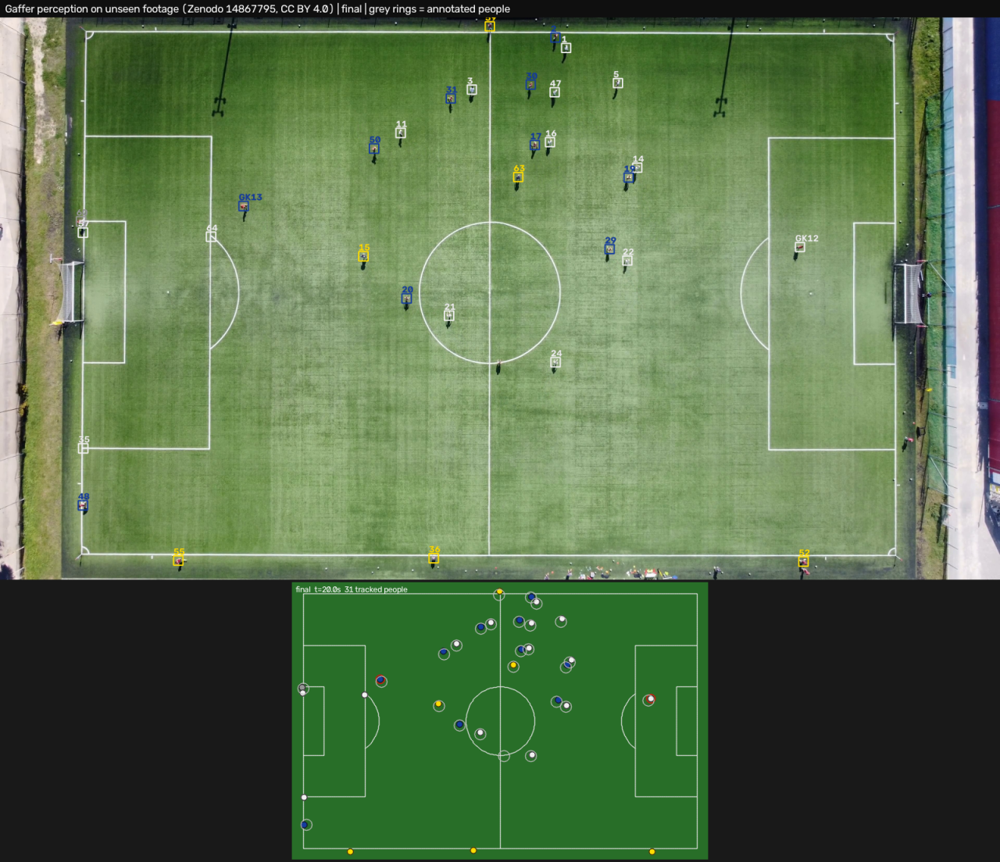

<p align="center"></p>

# Gaffer: a self-verifying tactical analyst for grassroots football

**Technical report** · OpenCV AI Competition 2026, powered by AWS

**Haider Sultan** · FAST-NUCES, Pakistan · 24 October 2026

Live app: <https://gaffer-tactics.duckdns.org><br>
Code: <https://github.com/haiderchaudarry96-stack/Gaffer>

## Executive summary

Professional clubs pay thousands for tactical analysis; a grassroots or university coach has a camera and no analyst. The question that matters most is hard to answer from the touchline: has the other team just changed shape?

Gaffer watches drone or high fixed-camera video with OpenCV 5, maps every player onto a 2D pitch, reads each team's formation over a 30 s window, updated every 5 s, and flags candidate shape changes. An agent on Amazon Bedrock (Amazon Nova 2 Lite) sends OpenCV back to check the camera and re-read the window at a higher frame rate; deterministic rules then confirm, reject or mark the candidate uncertain. A confirmed change becomes an alert with an evidence image, which the coach approves or rejects.

Results:

- On 10 held-out synthetic matches (38 real shape changes), false alerts fall from **34 to 9** while **32 of 38** real changes are kept.
- Detection F1 at 1 m on real drone footage: **0.918** and **0.930** on two TeamTrack windows; team accuracy 98.4 % and 98.8 %.
- On an unseen ground, per-video self-calibration lifts detection F1 from **0.567 to 0.855**.
- On real footage, White's 4-4-2 → 3-4-3 change at **16:30** is confirmed with evidence.
- Bedrock cost: **$0.021** per 90-minute synthetic match.

Limits: real footage covers one match and one 30 s clip of another ground, the demo window was chosen with the ground truth, the rules (not the LLM) make the decisions, and moving or broadcast cameras are not supported.

## Contents

1. [Problem](#1-problem)
2. [Users](#2-users)
3. [Architecture](#3-architecture)
4. [OpenCV 5 implementation](#4-opencv-5-implementation)
5. [The self-verifying agent](#5-the-self-verifying-agent)
6. [Agentic Vision Award evidence](#6-agentic-vision-award-evidence)
7. [AWS deployment](#7-aws-deployment)
8. [Evaluation](#8-evaluation)
9. [What we tried that did not work](#9-what-we-tried-that-did-not-work)
10. [Limitations](#10-limitations)
11. [Responsible use](#11-responsible-use)
12. [Conclusion and future work](#12-conclusion-and-future-work)
- [References](#references)
- [Appendix A: Agent trace examples](#appendix-a-agent-trace-examples)
- [Appendix B: Reproduce](#appendix-b-reproduce)

## 1 Problem

Professional clubs buy tactical analysis (tracking data, analysts, broadcast graphics) that costs thousands per season. A grassroots or university coach has a phone, perhaps a drone or a volunteer filming from a high spot, and no analyst. The question that matters most in a match is simple to ask and hard to answer in real time: **has the other team just changed shape, and what does that mean for us?**

Gaffer watches the match video, reads each team's formation over time, flags the moment a team switches shape, and **verifies the flag before it speaks**. Verification is the point: a formation read from video is noisy (players hidden at a free kick, a drone that wobbles, a shadow read as a person), and an assistant that raises an alert on every wobble is worse than none. Gaffer sends OpenCV back to look again before it alerts, and says "uncertain" when the footage does not support an answer.

## 2 Users

The main users are **grassroots and university coaches** with an elevated camera (a drone or a high fixed position) and no analyst. They need an alert only when the change is real, evidence they can take in within seconds (an annotated frame and the shape before and after), a reason in plain words, and control: they approve or reject every alert. They do not need a dashboard of 200 metrics. The second group are **judges and visitors** trying the live demo; they can do everything a coach can, including uploading their own video and confirming its pitch corners. Figure 1 shows the use cases and the two supporting systems.



*Figure 1: Use cases. The coach is linked to all eight; the hollow arrow (UML generalisation) means a judge or visitor can do everything a coach does, including uploading their own video and confirming its pitch corners.*

The web app is one desk (Figure 2): the video beside a 2D pitch, a shape timeline and one alert card at a time. The demo uses an amateur university match from the TeamTrack dataset [1] (MIT licence), the kind of footage a grassroots coach can produce.



*Figure 2: The coach's desk: video, 2D pitch, shape timeline and the 16:30 alert with its evidence image and the approve and reject buttons.*

## 3 Architecture

Figure 3 shows the deployed system (editable SVG sources and their generator: [docs/diagrams](diagrams/)).


*Figure 3: Architecture. OpenCV 5 does the seeing on Amazon EC2; Amazon Nova 2 Lite on Bedrock reads only numbers and short text.*

Three design rules hold the system together.

1. **A frozen data contract.** `match_state.json` (per-frame positions, teams, quality) and `tactical_timeline.json` are versioned at v1.0 ([data contract](DATA_CONTRACT.md)). The synthetic match generator and the real-video pipeline emit the same schema, so the tactics engine and the agent were built and measured on synthetic matches with exact ground truth before any real video was processed.
2. **The agentic vision loop.** The tactics engine only produces *candidates*. The agent decides what happens to each: check the camera, look again at a higher rate, then confirm, reject or mark uncertain. An OpenCV result must change what the agent does next, and the trace shows it.
3. **Query, never stuff.** The LLM never receives pixels or raw coordinates. Tools return small JSON (under 1 KB per result), and decisions must cite tool results by reference.

The code is organised as `src/gaffer/perception/` (OpenCV pipeline), `tactics/` (formations, change detector, metrics), `agent/` (tools, rules, loop, explanations, report, posture), `api/` (FastAPI backend) and `aws/` (S3 asset fetch), with the React frontend in `web/` and Docker and EC2 scripts in `deploy/`.

## 4 OpenCV 5 implementation

OpenCV 5 [3] (version 5.0.0, `opencv-contrib-python==5.0.0.93`, pinned in `requirements.lock`) is both the inference engine and the geometry engine. There is no PyTorch and no Ultralytics code. The version is printed by `scripts/smoke_test_opencv.py` and reported by `/api/health`.

### 4.1 Perception: from video to positions

Table 1 lists the perception steps that turn a video into `match_state.json`. Timings per stage are printed for every run; accuracy is in [Section 8](#8-evaluation).

*Table 1: Perception steps and the OpenCV 5 functions they use.*

| Step | What happens | OpenCV 5 functions |
|---|---|---|
| Pitch and homography | Painted lines are isolated with a top-hat line mask, thinned to centre lines and snapped to an IFAB pitch model; a homography maps pixels to metres. On an upload the four pitch corners are found automatically and shown to the coach for a yes or no. | `cv2.morphologyEx` (top-hat), `cv2.ximgproc.thinning`, `cv2.fitLine`, `cv2.findHomography`, `cv2.perspectiveTransform` |
| Drone drift | A hovering drone moves, so every sampled frame is re-aligned to the calibration frame on the pitch-line image; ORB with RANSAC is the fallback when the line image does not correlate. | `cv2.phaseCorrelate`, `cv2.findTransformECC`, `cv2.ORB_create`, `cv2.estimateAffinePartial2D` |
| Detection | Drone view: a classical detector (colour-based foreground against a per-video grass model, blob size from the homography). Side view: YOLOX-S [4] from the OpenCV Model Zoo [5], run on tiles through `cv2.dnn`. | `cv2.dnn.readNet`, `cv2.dnn.blobFromImage`, `cv2.connectedComponentsWithStats`, `cv2.morphologyEx` |
| Tracking | ByteTrack [6] (the MIT-licensed `supervision` library [7]) on the detections. | none (tracking library) |
| Team colours | Torso colour in Lab; two team clusters plus referee and keeper clusters; one vote per track. | `cv2.kmeans`, `cv2.cvtColor` |
| Positions | Foot points projected to pitch metres; people off the pitch dropped; attacking direction inferred from the goalkeepers. | `cv2.perspectiveTransform` |
| Side camera (experimental) | Four distortion models compared; the side view is near-rectilinear, so two sectioned homographies are used. | `cv2.fisheye.*`, `cv2.findHomography` |

The drone pipeline does not detect the ball, so possession, pressing and ball-aware set-piece logic are not available on that view.

### 4.2 Per-video self-calibration

The first detector was tuned on one overcast TeamTrack day. On an unseen ground (a Zenodo drone clip [2]: artificial turf, low sun, player shadows as long as the players, light-pole shadows across the pitch, staff and spare balls behind the lines) it produced 63 detections per frame for 25 annotated people (precision 0.40) and gave a team to only 41 % of the players. `perception/selfcal.py` now learns the calibration from each video, with OpenCV only, and every part is a configuration switch:

- a **grass model** from the first frame's pitch pixels (`cv2.calcHist` hue peak, robust percentiles); **shadows** (darker, cyan-shifted, saturated turf) count as background, and thin elongated blobs are rejected;
- the **expected player size** from the homography at each blob, and a working resolution of 14.7 px/m whatever the drone height;
- **static objects** (detections that recur at the same pitch point in 60 % of frames) are dropped;
- a **pitch mask**: detections more than 1.5 m outside the confirmed pitch are dropped;
- the **team colour from the player's own foreground pixels**, and a **team gate** set from this video's colour distribution.

Settings were chosen only on the TeamTrack development clip and the first 10 s of the Zenodo clip; the test part (10–26.7 s) was unseen. Results are in [Section 8.3](#83-an-unseen-ground). Table 2 shows what each part contributes on that test part, with the final configuration.

*Table 2: Leave-one-out on the unseen Zenodo test part (final configuration).*

| Part switched off | Detection F1 at 1 m | Strict coverage, home / away (%) |
|---|---|---|
| none (final) | 0.855 | 96 / 76 |
| shadows | 0.709 | 0 / 40 |
| crop foreground | not reported | 33 / 51 |
| adaptive team gate | not reported | 8 / 73 |
| local scale | not reported | 92 / 79 |
| static objects | not reported | 91 / 79 |
| grass model | not reported | 96 / 76 |
| pitch mask | not reported | 96 / 76 |

Source: `outputs/eval_zenodo_final.json`, `outputs/eval_zenodo_fno_*.json` (each file records `crop_exclude_lines: false`).

An earlier set of runs (`outputs/eval_zenodo_no_*.json`) had the `crop_exclude_lines` switch **on** (without shadows F1 0.709; without crop foreground 58 / 39 %; without the adaptive gate 5 / 61 %; the other parts about no difference). The final configuration has it **off**, because it lowered team accuracy on the Zenodo tuning third from 0.96 to 0.85. Both sets agree on what matters; the final set is the one to quote. One 30 s clip shows which parts mattered on that ground, not that every part matters everywhere.

Self-calibration has a cost on TeamTrack: about 10 % more ID switches (1.61 → 1.80 and 1.31 → 1.41 per player-minute on the two evaluation windows), and 1.17 instead of 0.99 s of processing per video second on the development clip (idle laptop).

### 4.3 Faster re-anchoring on difficult footage

On the unseen ground the per-frame re-anchoring ("geometry") dominated the run: 110 s of geometry in a 134 s run on an idle laptop, 4.39 s per video second (`outputs/eval_zenodo_a4_before.json`; an earlier figure of 421 s came from a busy laptop). Profiling 24 Zenodo frames (`outputs/a4_geo_bench.json`) showed why: `cv2.findTransformECC` at the working scale (0.25) missed the 0.6 correlation floor on 21 of 24 frames, because low sun and shadows weaken the line image, so those frames paid for a failed ECC plus the ORB fallback on the full 4K frame (0.89 s per frame, against 0.09 s on TeamTrack).

The fix is one switch, `drift.coarse_to_fine`: ECC first runs at half the working scale (a wider basin, a quarter of the pixels), and its rescaled warp starts the normal ECC; if the coarse pass fails, the old phase-correlation start is used. Table 3 compares the two.

*Table 3: Re-anchoring before and after the coarse-to-fine start.*

| Measurement | Before | After (`coarse_to_fine` on) | Source |
|---|---|---|---|
| Zenodo, 24 frames: s per frame; ORB fallbacks | 0.888; 21 | 0.097; 0 | `outputs/a4_geo_bench_c2f.json` |
| Zenodo, 24 frames: median line error (m) | 0.075 | 0.079 | same |
| TeamTrack development clip, 24 frames: s per frame; line error (m) | 0.089; 0.087 | 0.089; 0.087 (identical alignment) | same |
| Zenodo unseen test: P / R / F1 at 1 m | 0.7648 / 0.9702 / 0.8553 | 0.7616 / 0.9702 / 0.8533 | `outputs/eval_zenodo_a4_before.json`, `…_a4_after.json` |
| Zenodo unseen test: team accuracy (%) | 98.25 | 98.1 | same |
| Zenodo whole run: geometry (s); s per video s | 109.9; 4.39 | 18.2; 1.29 | same |
| TeamTrack evaluation window: F1; team accuracy (%); IDF1 | 0.9185; 98.36; 0.526 | identical | `outputs/eval_tracking_top_a4_before.json`, `…_a4_after.json` |
| TeamTrack evaluation window: formation agreement, White / Blue (%) | 100.0 / 90.0 | identical | `outputs/eval_real_a4_before.json`, `…_a4_after.json` |
| TeamTrack evaluation window: s per video s | 1.269 | 1.227 | same |
| TeamTrack second window: F1; team accuracy (%); IDF1 | 0.930; 98.8; 0.457 | 0.930; 98.8; 0.457 | `outputs/eval_second_set_tracking_top_final.json`, `…_c2f.json` |
| TeamTrack second window: formation agreement, White / Blue (%) | 93.5 / 88.1 | 93.6 / 88.1 (one more window both-confident, 47 of 48) | `outputs/eval_second_set_real_final.json`, `…_c2f.json` |
| TeamTrack second window: pipeline candidates; matched to the 2 oracle changes | 6; 2 | 4; 2 (two spurious out-and-back White candidates are gone) | same |
| Demo window as one 4K upload (rules only): s per video s; geometry (s); wall (s) | 3.06; 559.6; 2,738.6 | 2.75; 424.1; 2,703.1 | `outputs/upload_check/demo_final_full/upload_check.json`, `…/demo_c2f_full/…` |

**Decision: on.** The criterion set in advance was "on only if accuracy is the same within noise and time drops clearly". On the unseen ground F1 moves by 0.002 and the run is 3.4 times faster; TeamTrack output is identical or unchanged to the third decimal; the demo's 6 minutes, uploaded as one file, give the same 8 candidates, with White's change at 16:30 and Blue's change confirmed on the same windows (73 % of 11 and 75 % of 12). The whole upload barely moved because the agent's re-analysis budget (about 1,400 s) dominates, and neither upload was a controlled benchmark (one on a loaded laptop, one with an editor and browser open). A plain downscale was rejected (Section 9). On Amazon EC2 the 6-minute upload spent 148.1 s of its 403.2 s detection stage in geometry, 1.13 s per video second (Section 7).

### 4.4 From positions to formations

Per team, over a 30 s trailing window updated every 5 s, the tactics engine assigns the visible outfield players to each template formation (4-4-2, 4-3-3, 4-2-3-1, 3-5-2, 3-4-3, 5-3-2) with the Hungarian algorithm and an anisotropic template fit, turns the residuals into a softmax confidence, and labels the window `uncertain` when confidence is below 0.45 or fewer than 8 outfield players are visible. A hysteresis detector turns a changed label that holds for 20 s into a **candidate shape change**. 3-5-2 and 5-3-2 count as one family (wing-backs drop into a back five without the ball). Each window also carries metrics (defensive line, compactness, width, centroid); all thresholds are in `config.yaml`. The engine has been frozen since its first evaluation (apart from two options that are off).

### 4.5 Evidence images

For a confirmed change, OpenCV draws the frame with every player and the team's formation lines projected through that frame's own homography, plus before and after panels showing a typical window of each shape. The "before" window must have at most 25 % of the team's positions inside its own penalty area, so a set piece is not shown as the usual shape. The image is a JPEG of at most 1 MB.

## 5 The self-verifying agent

**Rules decide; the LLM orchestrates and explains.** For each candidate, the agent (Amazon Nova 2 Lite on Amazon Bedrock [8, 9]) runs the loop shown in Figure 4 (Section 6.1); the full design is in [the agent design notes](AGENT_DESIGN.md).

1. Read the candidate card (team, time, from → to, first-pass numbers).
2. Call `check_frame_quality` (OpenCV): are the pitch lines fitted in at least 90 % of sampled frames, is the camera still (shift ≤ 25 px/s, zoom change ≤ 3 %), is there a cut? A moving camera ends the candidate as **uncertain, with no alert**.
3. If coverage before the change is low or the footage is too short, call `reanalyse_window`: OpenCV re-runs the whole perception pipeline on that window at a higher rate (4–6 fps), within a time budget of 360 s per call and 1,200 s per match.
4. Deterministic rules (`agent/verify.py`, frozen, configuration fingerprint `ca4ff9bbf7b01c6c`) read the numbers: does the new shape hold in at least 60 % of the confident windows after detection (persistence), did the team go back to the old shape (revert), is this the return leg of an earlier change?
5. Call `record_decision` (confirmed, rejected or uncertain, citing tool results); for a confirmation, call `render_evidence` and then `propose_alert`, which **waits for the coach**.

A guard around the loop enforces the protocol: no alert before verification, no confirmation against the rules' verdict, at most 8 LLM calls and 3 vision calls per candidate, per-match caps (150 calls, 400 k tokens, $0.50), a rate limiter below the account quota, and a rules-only fallback if Bedrock is unreachable. The model's own text is **explanation only**: a separate step asks for one or two plain sentences from the code's facts, checks them (the cause is named, the decision is not contradicted, numbers come only from the facts, no ball, possession or pressing claims) and falls back to a code-written template when the check fails.

**What the evidence says.** In this report the **rules-only arm** means the deterministic rules without any LLM, and the **agent** means Amazon Nova 2 Lite driving the same tools under the same rules. The verified pipeline cuts false alerts sharply (Section 6.3: 34 → 9). Those decisions come from the rules: the agent's decisions were identical to the rules-only arm's on all 68 candidates. The LLM adds orchestration (which window, which rate) and wording, not better verdicts. We state this plainly because the Agentic Vision criterion is that **OpenCV output changes what the agent does next**; that holds in the design and in the traces (Section 6.2), and it is not the same as claiming the LLM is smart.

## 6 Agentic Vision Award evidence

This section gathers the four items the award asks for, each with its source.

### 6.1 Workflow diagram


*Figure 4: Agent workflow. The highlighted loop is trace (a) from Appendix A, with its numbers.*

### 6.2 Traces in which an OpenCV result changes a later call or decision

Appendix A reproduces three recorded traces on real TeamTrack drone footage and states what each shows.

- **(a) White 4-4-2 → 3-4-3 at 16:30.** Only 52 % of the frames before the change show at least 8 White outfield players. `check_frame_quality` (OpenCV, 11.3 s) finds the camera still and the lines fitted in 100 % of frames; because coverage is low, the agent calls `reanalyse_window` at the **highest** rate (6 fps rather than 4), so **the OpenCV result chose the next call's arguments**. The result, 3-4-3 in 91 % of 11 clear readings, leads to confirmed → `render_evidence` → pending alert. The first pass alone would also have confirmed: OpenCV decided the path and produced the evidence, not the verdict.
- **(b) Blue 3-5-2 → 4-4-2 at 26:35.** The first pass says "reverted after 55 s"; the second look at 4 and 6 fps finds **no revert** (the new shape holds in only 17 % of 12 readings). The candidate is still rejected, for a different reason.
- **(c) Simulated pan and zoom on real frames.** `check_frame_quality` measures 190 px/s of camera motion, a 30 % zoom change and lines fitted in 33 % of frames, so the agent **refuses**: no re-analysis, and **uncertain** where the first pass alone says reject. This is the one case in which an OpenCV result changes both the next call and the decision on real frames; the camera motion is synthetic.

We claim no more. On 14 real candidates the decision always equalled the first pass alone ([agent design notes](AGENT_DESIGN.md), section 14); on synthetic matches the rules' second look changes decisions systematically, which is where the reduction from 34 to 9 false alerts comes from.

### 6.3 Evaluation of task success

The task is to raise an alert on a real tactical shape change and not on noise. Table 4 compares three arms on 10 held-out synthetic matches (seeds 110–119, 38 real shape changes), run once with frozen rules.

*Table 4: Alert quality on 10 held-out synthetic matches.*

| Arm | Real changes alerted | False alerts | Uncertain | Real changes rejected | Mean alert delay (s) |
|---|---|---|---|---|---|
| One-shot (alert on every candidate) | 34 / 38 | 34 | 0 % | 0 | 42 |
| Rules only (no LLM) | 32 / 38 | 9 | 2 % (1 / 68) | 2 | 105 |
| Agent (Amazon Nova 2 Lite) | 32 / 38 | 9 | 2 % (1 / 68) | 2 | 105 |

Source: `outputs/eval_agent_final.json`.

The bar was fixed before the run (false alerts ≤ 16 **and** ≥ 30 / 38 real changes alerted, uncertain ≤ 30 %, delay ≤ 120 s) and is met. Cost: 195 LLM calls (2.9 per candidate), $0.21 in total, $0.021 per match, with no throttling. All 68 decisions equal the rules-only arm's (0 guard blocks, 0 invalid calls, 0 fallbacks). The set is untouched by the agent's design but not unseen: the tactics engine's output on these seeds had been looked at earlier ([agent design notes](AGENT_DESIGN.md), section 8).

### 6.4 Failure handling, observability and human control

*Table 5: Failure handling, observability and human control.*

| Aspect | What exists | Source |
|---|---|---|
| **Failure handling** | Throttling: backoff plus a client-side limiter at 18 requests per minute. Model access error: Nova Micro fallback. Malformed tool call: an error result; two in a row send that candidate to the rules. Bedrock unreachable or caps spent: the remaining candidates go to the rules (`decided_by: rules (llm unavailable)`). Camera moved or cut: refuse, no alert. Clip too short for the look-ahead: uncertain. OpenCV over budget: a refusal stating the longest window that would fit. Looping: the third identical call ends the candidate. An explanation that fails its check: the code template. | [Agent design](AGENT_DESIGN.md), section 6; `config.yaml` `agent.limits` |
| **Observability** | `outputs/llm_calls.jsonl` (model, tokens, latency and cost per call), `outputs/agent_trace.jsonl` (every tool call with its arguments, a result summary and the duration, chained by `prev_ref`), `outputs/alerts.jsonl` (every alert and the coach's decision, append-only). On EC2 all three, plus the chat, posture and per-analysis traces, go to the Amazon CloudWatch log group `/gaffer/app` (7 streams), with the metrics `Gaffer/AnalysesCompleted` and `Gaffer/BedrockCalls`. The app shows the trace of each candidate. | [Agent design](AGENT_DESIGN.md), section 7; [AWS deployment guide](../deploy/DEPLOY_AWS.md) |
| **Human control** | `propose_alert` creates a **pending** alert. The coach approves or rejects it in the app (or with `py -m gaffer.agent.alerts --approve` or `--reject`); the decision is appended with a note. Uncertain and rejected candidates raise no alert, and the reason is shown. Coach decisions never change the verification record. | `src/gaffer/agent/alerts.py` |

## 7 AWS deployment

### 7.1 Services

Gaffer is live at **<https://gaffer-tactics.duckdns.org>** in Sydney (ap-southeast-2), with a Let's Encrypt [11] certificate (plain-http fallback: <http://13.210.196.109/>). It was first deployed on 22 October 2026 and the current build on 24 October ([AWS deployment guide](../deploy/DEPLOY_AWS.md)).

- **Amazon EC2** `m7i-flex.large` (2 vCPU Intel, 8 GiB) runs two Docker containers: Caddy [10] (TLS with an automatic Let's Encrypt certificate) in front of the app (FastAPI, the single OpenCV 5 analysis worker and the built frontend). It has a 30 GB gp3 volume, an Elastic IP, a DuckDNS name and a security group with ports 80 and 443 only (no SSH).
- **Amazon Bedrock**: Amazon Nova 2 Lite through the global inference profile `global.amazon.nova-2-lite-v1:0`, with Nova Micro (`apac.amazon.nova-micro-v1:0`) as fallback, called with the **instance role** (`credentials: iam-role` in `/api/health`). The API's Bedrock calls are capped at 300 calls and $1.00 per UTC day.
- **Amazon S3**: the private bucket `gaffer-demo-221039325928` (SSE-S3) holds 14 assets (replay clips, sample clip, model; 593.6 MB on 22 October, since when the TeamTrack sample has shrunk by 186 MB), fetched at container start, plus source tarballs for redeploys.
- **Amazon CloudWatch**: log group `/gaffer/app` (14 days) and two metric filters.
- **IAM**: role `gaffer-ec2-role` (Systems Manager core plus an inline policy for Nova 2 Lite and Nova Micro, the one bucket and the one log group). No access keys exist on the instance or in the image. **AWS Systems Manager** (Session Manager and Run Command) does the deploys.
- **Cost**: about $0.13 per hour or $3.10 per day while running, and about $0.22 per day when stopped.

The Free plan refused the Graviton instance `t4g.large` ("not eligible for Free Tier"), so the largest eligible type is the Intel `m7i-flex.large`.

### 7.2 Observed on the live server

On 22 October the first build answered a health check from the internet in 0.57 s, replayed the recorded match end to end (12 clips, 11 seeks, 11 handoffs, reveal at 1085 s), analysed a 6-minute 4K upload in 1,888 s (31.5 min; 1,208 s of it the OpenCV re-analysis budget), answered a grounded Bedrock chat question in 5.4 s, kept an approved alert across an instance reboot, and delivered all seven log streams and both metrics ([build record](../RECORD.md)). Table 6 compares it with the current build, measured on 24 October on the same instance through the public HTTPS URL and the normal upload path, with Amazon Nova 2 Lite on Bedrock.

*Table 6: The live server, first build (22 October) and current build (24 October).*

| Measurement | 22 October build | 24 October build (self-calibration, coarse-to-fine re-anchoring, HTTPS) |
|---|---|---|
| Redeploy (`deploy.sh`) | image build 53 s, healthy 64 s after the start | build 15 s (Docker cache), app up 25 s, certificate issued and HTTPS answering 30 s after the start |
| TeamTrack 30 s 1080p sample, end to end | analysis 12.7 s wall (server log) | **23.5 s** (pitch check 3.4 s + analysis 20.2 s; 0.55 s per video second; server log 19.1 s wall) |
| Zenodo 30 s 1080p sample, end to end | not offered yet | **23.0 s** (pitch check 2.9 s + analysis 20.1 s; 0.56 s per video second; server log 18.8 s wall) |
| 6-minute 4K upload (the demo's 12 clips joined, 360.4 s) | 1,892.9 s wall (server log): detection 464 s, agent 1,412 s | **1,679.9 s wall** (28.0 min): detection stage 403.2 s (1.13 s per video second), agent stage 1,272.2 s, of which OpenCV re-analysis 1,064.9 s |
| Result of the 6-minute upload | 8 candidates: 1 confirmed, 4 rejected, 3 uncertain | 8 candidates: **2 confirmed** (White 4-2-3-1 → 3-4-3 at 16:30, held in 83 % of 12 windows; Blue 4-2-3-1 → 4-4-2 at 16:25, 75 % of 12), 3 rejected, 3 uncertain; the same 8 as on the laptop (Section 8.5) |
| Bedrock for the 6-minute upload | 47 calls, $0.049 | 49 calls, $0.052 (+ 2 posture calls, $0.0031) |
| Amazon CloudWatch | 7 streams, 2 metrics | new `caddy` stream; `app`, `llm_calls` and `analysis_trace` streams written; `BedrockCalls` 51 and `AnalysesCompleted` 3 for 24 October, equal to the server's own counter (51 calls, $0.0538) |

Source: `outputs/sample_timing_ec2.json`, `outputs/ec2_upload_6min_24oct.json`, CloudWatch.

The samples take longer than on 22 October (12.7 s to 19.1 s server-side for the TeamTrack clip), most likely because of the self-calibration passes (not isolated on EC2); the 6-minute run is 11 % shorter.

## 8 Evaluation

Each result comes from one of four sources: **synthetic** matches (exact ground truth; tactics engine and agent), **TeamTrack** [1] (one real match, drone view, first half; perception and formations against annotations), **Zenodo** [2] (one unseen drone clip) and a **720p** copy of the demo window. Every number names its source file and is cross-checked in the [final audit](FINAL_AUDIT.md). Where a timing was measured on a busy laptop, the text says so.

### 8.1 Tactics engine on synthetic matches

Table 7 gives the engine's results on the held-out seeds 110–119 (10 matches of 90 minutes, engine unchanged since its first evaluation).

*Table 7: Tactics engine on 10 held-out synthetic matches.*

| Measure | Value |
|---|---|
| Formation accuracy per 30 s window, when confident | 97.7 % overall (full view 97.6 %, broadcast-window view 98.0 %); strict (uncertain counts as wrong) 77.4 % |
| Shape changes (38 true, ±90 s) | 34 hits, 4 misses (3 found late after low visibility), **34 false positives**, mean delay 42 s (max 125 s); new formation right in 31 of 34 hits |
| Causes of false positives | set piece 14, other 11 (18 of the 34 are 4-3-3 ↔ 4-2-3-1 flips, 16 of them in one seed), partial view 8, counter-attack 1 |
| Timeline JSON size | max 14.0 KB, mean 6.3 KB |

Source: `outputs/eval_synthetic_heldout2.json`.

The generator and the engine share one model of a formation, so 97.7 % is an upper bound for real footage. The agent's effect on these candidates is in Section 6.3 (34 → 9 false alerts).

### 8.2 Real footage: TeamTrack drone view

Two windows of the same match are evaluated: the **evaluation window** (match time 1560–1800 s, 8 clips) and the **second window** (1260–1530 s, 9 clips), never tuned on but **not independent** of the first (same match, cameras and teams, neighbouring minutes). Calibration (31 landmarks) and team colours were chosen on a separate development clip (1530–1560 s). Table 8 uses the final settings.

*Table 8: Detection, teams, tracking and formations on the TeamTrack drone view.*

| Metric | Evaluation window (1560–1800 s) | Second window (1260–1530 s) |
|---|---|---|
| Detection F1 at 1 m (raw) | 0.918 (P 0.872, R 0.970) | 0.930 |
| Detection F1, unannotated referees removed | 0.984 | 0.990 |
| Team accuracy, settled labels (%) | 98.4 | 98.8 |
| IDF1; ID switches per player-minute | 0.526; 1.80 | 0.457; 1.41 |
| Formation exact agreement with the ground-truth-position oracle, White / Blue (%) | 100.0 / 90.0 | 93.5 / 88.1 |
| Candidates | all 3 oracle changes matched; 5 pipeline candidates | all oracle changes matched; 6 pipeline candidates |

Source: `outputs/eval_tracking_top_final.json`, `outputs/eval_second_set_tracking_top_final.json`, `outputs/eval_real_final.json`, `outputs/eval_second_set_real_final.json`.

The "oracle" runs the same tactics engine on the annotated (ground-truth) positions. Calibration has a held-out landmark error of 0.11 m mean on the drone view (31 landmarks; [data notes](DATA_NOTES.md)). Pitch auto-detection for uploads is correct on 180 of 180 frames from 60 drone clips after a fix for a turf edge taken for a goal line (`outputs/eval_autodetect.json`); the fix was made on these clips, so this number is not held out. The side camera (a fixed panorama that looks like a fisheye) is experimental: detection F1 0.49 at 1 m raw (0.78 at 2 m), 3.4 s per frame, and its alerts are capped at "uncertain".

### 8.3 An unseen ground

The Zenodo record [2] (CC BY 4.0) provides a 30 s 4K drone clip with annotated people. Settings were chosen on the TeamTrack development clip and Zenodo 0–10 s; the **unseen test part is 10–26.7 s**. Table 9 shows the effect of self-calibration, and Figure 5 shows a test frame.

*Table 9: Perception on the unseen Zenodo ground, before and after self-calibration (1 m matching).*

| Metric | Before self-calibration | After |
|---|---|---|
| Precision / recall / F1 | 0.396 / 0.999 / 0.567 | 0.765 / 0.970 / 0.855 |
| Detections per frame (25.0 annotated) | 63.1 | 31.7 |
| Players with a team label (%) | 41 | 95 |
| Team accuracy (%) | 81 | 98 |
| Strict coverage: frames with ≥ 8 correctly-teamed annotated outfield players, home / away (%) | 0 / 10 | 96 / 76 |

Source: `outputs/eval_zenodo_before.json`, `outputs/eval_zenodo_final.json`.



*Figure 5: The unseen ground after self-calibration: tracked people with team colours (top) and the 2D pitch (bottom); grey rings mark annotated people. Zenodo record 14867795, CC BY 4.0.*

About 6 false detections per frame remain (staff within 1 m of the touchline, painted-line junctions), and the auto-detected pitch has one corner 1.4 m off in the final run (1.74 m in the first run) against the corners implied by the annotations, so the "every corner within 1 m" rule fails here. This is one 30 s clip of one ground.

### 8.4 720p against 4K

Table 10 compares a 720p copy of the demo window (match time 900–1260 s, TeamTrack training split, so not held out) with the 4K original, using the default configuration ([data notes](DATA_NOTES.md), section 13).

*Table 10: The demo window at 4K and at 720p.*

| Metric | 4K | 720p |
|---|---|---|
| Detection F1 at 1 m, raw / referees removed | 0.928 / 0.978 | 0.928 / 0.958 |
| Team accuracy (%) | 99.0 | 98.5 |
| IDF1 | 0.468 | 0.416 |
| Formation exact agreement, White / Blue (%) | 91.7 / 86.2 | **74.1** / 82.8 |
| White's 16:30 change found | yes | yes |
| Processing time per video second, laptop (s) | 1.42 | 0.34 |

Source: `outputs/teamtrack_720p_check/report.json`.

The raw F1 is equal only because 720p finds half as many unannotated referees; on players alone 720p is worse (recall 0.973 → 0.926). The 720p copy is a downscale of the 4K file, not a native 720p camera.

### 8.5 Upload consistency

The demo's 6 minutes (match time 15:00–21:00) were also run as one upload through the normal path (auto-detected corners, rules only, laptop). White's change at 16:30 is found and **confirmed**, but read as 4-2-3-1 → 3-4-3 (held in 73 % of 11 windows): White is defending a free kick between 15:45 and 16:30 with only 7.1–7.6 of 10 outfield players visible, so the "from" shape is ambiguous and one 5 s window decides whether the 4-4-2 lasts the 20 s the engine needs. Blue's change at 16:25 is also confirmed. Eight of the 9 demo candidates have a counterpart with the same team and new shape; the other 6 candidates stay uncertain because the frozen 1,200 s re-analysis budget was spent on the first two.

With coarse-to-fine re-anchoring on (`outputs/upload_check/demo_c2f_full/upload_check.json`) the upload gives the same 8 candidates and the same two confirmations (Blue 4-2-3-1 → 4-4-2 at 75 % of 12). One candidate (Blue 4-4-2 → 4-2-3-1 at 17:30) moves from uncertain to rejected (it reverted after 30 s), so 5 are uncertain instead of 6; the re-analysis took 1,434.5 s against 1,388.7 s. Why that decision moved was not investigated; the rules and the tactics engine are unchanged.

### 8.6 Sample clips end to end

On an idle laptop without Bedrock (`outputs/sample_timing.json`), the TeamTrack 1080p sample takes 20.6 s (pitch check 1.3 s + analysis 19.3 s) and the Zenodo 1080p sample 18.5 s (1.1 s + 17.3 s); runs on a busy laptop were about 3 times slower and are not quoted. The clips measure 14.0 and 14.7 px per metre, above the low-resolution threshold. On Amazon EC2 they take 23.5 s and 23.0 s end to end (Section 7.2).

The TeamTrack sample was re-encoded from 218.4 MB to 32.3 MB (H.264 CRF 16) so the Download link is usable, and accepted only after the analysis matched: same pitch (14.0 px per metre), White 4-4-2 and Blue 5-3-2, 0 candidates, a median position difference of 0.03 m; only referee-labelled detections changed (180 → 124) (`outputs/sample_clip_reencode.json`).

## 9 What we tried that did not work

Table 11 lists the main approaches that were measured and switched off or rejected.

*Table 11: Approaches that did not work.*

| What we tried | Result | Decision |
|---|---|---|
| Pretrained YOLOX (COCO) on the 4K drone view | Players are small: recall 0.06 on tiles, 0.54 with 2× upscaled tiles at 18 s per frame | Rejected for a classical detector (F1 0.906 on the first evaluation; `outputs/compare_detectors_top.json`); YOLOX stays the side-view detector |
| Calibration tiers: an OpenCV health check, then a numbers-only Nova proposal | Tier 1 (turn `local_scale` off below 14.7 px/m) made the TeamTrack check worse: detections per frame 21.8 → 12.8, White outfield points 8.3 → 2.6, team-labelled share 0.86 → 0.77. Tier 2 never triggered. One real Nova call said 0.75 was "lower than 0.6". | Off. The "69 % duplicate detections" behind the idea came from a generated 7.4 px/m clip; the real 720p copy (9.3 px/m) measured 5.9 % |
| A metric check on 4-3-3 ↔ 4-2-3-1 confirmations | Cross-validated: false alerts 23 → 19, real changes alerted 67 → 66; the criterion set in advance was −5 false alerts | Off |
| Rejecting a return leg only if persistence also fails | Real changes alerted 67 → 67, false alerts 23 → 48 | Off; Blue's 18:50 change stays missed (Section 10) |
| 4-3-3 and 4-2-3-1 as one family for change detection | False positives 34 → 16, hits 34 → 28 (all six lost are real switches) | Off |
| A line-drop event | 1.70 false alarms per match on seeds 110–119, none on real clips | Off |
| Plain downscaling for re-anchoring (scale 0.125) | 0.035 s per frame, but median line error 0.075 m → 0.121 m | Rejected for the coarse-to-fine start (Section 4.3) |
| Stronger compression of the TeamTrack sample (CRF 23, 8.6 MB; also CRF 12, 63.2 MB) | CRF 23: Blue read as 4-2-3-1, referee-labelled detections 180 → 75. CRF 12 was no closer than CRF 16. | Rejected; CRF 16 (32.3 MB) kept |
| A frame-by-frame LLM | Not tried: the cost and latency of reading pixels are exactly what "query, never stuff" avoids | Not built |

The full list of failure cases with images is in [the failure log](FAILURE_LOG.md).

## 10 Limitations

1. **One real match, first half.** All real-footage numbers come from one TeamTrack match (drone view), and the two evaluation windows are neighbouring minutes of it. The 98–99 % team accuracy and 0.92–0.93 F1 do not show how Gaffer behaves with another club's kit and ground.
2. **Zenodo is one 30 s clip of one other ground.** Self-calibration helped a lot there, but it is a single clip, settings were chosen on its first third, and one auto-detected pitch corner is 1.4–1.7 m off.
3. **The demo window (900–1260 s) was chosen with the ground truth.** It was picked because the ground-truth positions show the half's two lasting changes there, so the confirmed 16:30 alert is a demonstration, not a random sample. No candidate is confirmed in the other real windows.
4. **The LLM does not change the decisions.** All 68 decisions equal the rules-only arm's. The agent's value is orchestration, evidence and wording; the false-alert reduction (34 → 9) comes from the rules' second look.
5. **A missed change.** Blue's 4-4-2 → 4-2-3-1 at 18:50 is real (it holds for 220 s in the ground-truth positions) but is rejected by the return-leg rule because it reverses Blue's change at 18:00, although the 6 fps second look saw 4-2-3-1 in 100 % of 12 readings. The tested fix adds 25 false alerts on synthetic data, so it stays off.
6. **Panning or zooming cameras and broadcast footage are not supported**, and are refused by design. A fixed side camera is experimental, with its alerts capped at "uncertain".
7. **720p reads formations less reliably.** Gaffer is tested mainly on 4K drone video; on one 720p clip White's formation agreement fell from 91.7 % to 74.1 %. Generated low-resolution clips (7.4 px/m) show duplicate detections; real 720p footage did not.
8. **Long clips are slow.** The Free plan allows no Graviton and no larger Intel type than `m7i-flex.large`; a 6-minute 4K upload took 28.0 minutes on the server (1,679.9 s; 31.5 minutes on the first build). Uploads are limited to 6 minutes.
9. **The competition's "Best Use of COOL" track was not pursued.** It was first on the project's cut list, and the time went to the vision pipeline, the agent and the evaluation.

## 11 Responsible use

- **No faces, no identities.** Players are anonymous dots and boxes; there is no face model and no shirt-number reader, and evidence images are top-down frames at drone scale. Gaffer is not used on identifiable minors: a YouTube U13 clip considered for a stress test was looked at by eye only (the local copy is gitignored; frames are never committed or shown) and is not part of any result ([data sources](DATA_SOURCES.md)).
- **Only licensed data, with credit.** TeamTrack [1] (MIT, Scott et al., 2024) and the Zenodo preview clip [2] (CC BY 4.0, Synowiec, Nowak and Kamola). No broadcast footage, no copyrighted music, no AGPL code, no Ultralytics weights; every source is in the [data sources](DATA_SOURCES.md).
- **What goes to Bedrock.** Numbers and short text only, never pixels: candidate cards, tool results (formation labels, metric values, coverage, timestamps), the code's reason strings and, for the chat, the typed question and the stored results. Chat questions are logged as typed, with no names or IP addresses (visitors are a random cookie id). Uploaded videos stay on the server.
- **Cost caps and budgets.** Bedrock: 300 calls and $1.00 per UTC day for the whole API, $0.30 per analysis, per-match agent caps (150 calls, $0.50) and 20 chat questions per visitor per day. AWS: the budget `gaffer-budget` with alerts, planned to rise to $40 per month for judging; Free-plan credits are watched too, because the account closes at $0.
- **The coach approves every alert.** `propose_alert` only creates a pending alert; nothing is sent or acted on automatically. Posture reads and role-level advice are advisory: the posture read often returns "unclear", role advice is a two-rule heuristic, and advice is conditional ("consider…"), names no player and never suggests an automatic substitution.
- **"Uncertain" instead of guessing.** A moving camera, too little footage, an exhausted budget, a side camera or weak evidence all end in `uncertain` with the reason shown, and the engine labels a window `uncertain` below 0.45 confidence. Explanations and chat answers are checked against the stored results and replaced by a safe answer when not grounded; one live chat grounding failure was caught this way, and its fix was tested with a fake model only.

## 12 Conclusion and future work

Gaffer shows that a self-verifying loop makes a formation-change detector usable: on held-out synthetic matches the rules' OpenCV second look removes most false alerts (34 → 9) while keeping 32 of 38 real changes, and on real drone footage the system detects players and teams reliably (F1 0.918–0.930, team accuracy 98–99 %) and confirms one real change with evidence. The evidence has clear bounds: one real match, one clip of a second ground, a demo window chosen with the ground truth, and an LLM that orchestrates and explains but does not improve the decisions.

Future work, none of which is built yet:

- **Ball detection on the drone view**, so possession, pressing and set pieces can inform the formation reading.
- **Panning and zooming cameras**, which need camera-motion compensation before positions can be trusted.
- **More grounds and more matches**, to measure generalisation beyond one match and one 30 s clip.
- **Separate in-possession and out-of-possession shapes**, the better fix for 4-3-3 ↔ 4-2-3-1 flips.

## References

1. A. Scott et al., "TeamTrack: A Dataset for Multi-Sport Multi-Object Tracking in Full-pitch Videos," 2024. arXiv:2404.13868. <https://arxiv.org/abs/2404.13868>. Dataset: Kaggle `atomscott/teamtrack`, MIT licence.
2. K. Synowiec, M. Nowak and M. Kamola, "Soccer pitch top-view: how it can help in player location accuracy estimation and improvement," Zenodo, 2025. DOI 10.5281/zenodo.14867795, CC BY 4.0. <https://doi.org/10.5281/zenodo.14867795>
3. OpenCV, Open Source Computer Vision Library, version 5.0.0. <https://opencv.org>, <https://github.com/opencv/opencv>
4. Z. Ge, S. Liu, F. Wang, Z. Li and J. Sun, "YOLOX: Exceeding YOLO Series in 2021," 2021. arXiv:2107.08430. <https://arxiv.org/abs/2107.08430>
5. OpenCV Model Zoo (YOLOX-S ONNX, `object_detection_yolox_2022nov.onnx`), Apache 2.0. <https://github.com/opencv/opencv_zoo>
6. Y. Zhang et al., "ByteTrack: Multi-Object Tracking by Associating Every Detection Box," ECCV 2022. arXiv:2110.06864. <https://arxiv.org/abs/2110.06864>
7. Roboflow, supervision (ByteTrack implementation), MIT licence. <https://github.com/roboflow/supervision>
8. Amazon Web Services, Amazon Bedrock User Guide (Converse API, inference profiles). <https://docs.aws.amazon.com/bedrock/latest/userguide/>
9. Amazon Web Services, Amazon Nova User Guide (Amazon Nova 2 Lite, Nova Micro). <https://docs.aws.amazon.com/nova/latest/userguide/>
10. Caddy web server, automatic HTTPS. <https://caddyserver.com/docs/automatic-https>
11. Let's Encrypt, a free, automated certificate authority. <https://letsencrypt.org>

## Appendix A: Agent trace examples

### A.1 How to read a trace

Each example comes from an agent run on real TeamTrack drone footage, with the rules frozen (configuration fingerprint `ca4ff9bbf7b01c6c`), copied from the recorded trace files. `R0` is the candidate card, the first pass over the stored positions; `R1`, `R2` and so on are tool results, the handles that decisions and alerts cite. The **actor** column says who made the call: "code" for the card, "Nova" for the agent (Amazon Nova 2 Lite) or "rules" for the rules-only arm. The **next** column is what the result made the agent do. Times are match clock (mm:ss). All cases come from one match, so they are traces, not accuracy numbers; accuracy is in Section 6.3.

*Table A1: Summary of the trace examples.*

| Example | Candidate | What OpenCV found | Effect on the next call | Decision |
|---|---|---|---|---|
| (a) | White 4-4-2 → 3-4-3 at 16:30 | camera still; second look at 6 fps: 3-4-3 in 91 % of 11 readings | re-read at the highest rate because coverage was low | confirmed (same as the first pass) → pending alert |
| (b) | Blue 3-5-2 → 4-4-2 at 26:35 | second look: no revert, new shape in only 17 % of 12 readings | none; the reason changes | rejected (same as the first pass) |
| (c) | Blue 3-4-3 → 4-4-2, simulated pan and zoom | camera moves 190 px/s, zoom changes 30 %, lines fit 33 % | second look skipped | uncertain (first pass alone: reject) |
| (d) | posture read after a confirmed event (mocked) | optional re-analysis of a bounded window | one follow-up model request | advisory posture, saved separately |

### A.2 White 4-4-2 → 3-4-3 at 16:30: low coverage, a second look at 6 fps, confirmed

The demonstration window is 15:00–21:00, chosen with the ground-truth positions because the half's two lasting changes happen in it. The agent is Amazon Nova 2 Lite on Bedrock (`outputs/agent_video_taskE/trace_llm.jsonl`); the rules-only arm (`trace_rules.jsonl`) made the same calls.

*Table A2: Trace (a).*

| Ref | Actor | Call | Key result | Next |
|---|---|---|---|---|
| R0 | code | candidate card | first pass: only 52 % of the frames in the 45 s before the change show at least 8 of White's outfield players (60 % needed) → rules `need_more`; missing: camera check, second look | check the camera |
| R1 | Nova | `check_frame_quality` 15:45–18:05 | OpenCV, 11.3 s: pitch lines fit 100 % of sampled frames, camera shift 0.4 px/s, zoom 0.2 %, no cut → camera usable; still `need_more` (coverage) | second look, highest rate |
| R2 | Nova | `reanalyse_window` 15:45–18:05 at 6 fps | OpenCV perception re-run on 840 frames (252 s on the laptop CPU in the rules run; a cache hit here): **3-4-3 in 91 % of 11 clear readings** over the 60 s after detection, no return to 4-4-2 → rules `confirm` | record it |
| R3 | Nova | `record_decision(confirmed)`, cites R1, R2 | reason written by the code: "new shape held in 91% of 11 confident windows over 60 s, no revert" | render the evidence |
| R4 | Nova | `render_evidence` | OpenCV: the 16:45 frame with every player and White's 3-4-3 lines projected through that frame's homography, plus before and after shape panels | create the alert |
| R5 | Nova | `propose_alert` | `alr_teamtrack_top_w900_1260_evt_003`, status **pending**: it waits for the coach to approve or reject | none |

Cost: 5 Nova calls, 15.7 k input and 0.4 k output tokens, $0.0058. The first pass alone would also have confirmed (85 % of 13 readings). The OpenCV results decided the path (a second look at 6 fps instead of 4 fps, because coverage was low) and produced the evidence; they did not change the decision. A later presentation change replaced the coach-facing text and the picture but not the decision (the trace was replayed and the decision asserted). The alert's explanation now reads "White played 3-4-3 from 16:30 because it stayed there in 91% of 11 clear readings over the next 60 seconds [R2]"; the earlier text said "held for over 20 seconds". The "before" panel now shows a typical 4-4-2 (15:05–15:35) instead of a set piece (`outputs/agent_video_step7/evidence/teamtrack_top_w900_1260/evt_003.jpg`).

### A.3 Blue 3-5-2 → 4-4-2 at 26:35: the second look contradicts the first pass

This is the drone evaluation window, 25:30–30:00, rules-only arm (`outputs/agent_video_final/trace_rules.jsonl`). The agent's run looked at 6 fps and found the same 17 % of 12.

*Table A3: Trace (b).*

| Ref | Actor | Call | Key result | Next |
|---|---|---|---|---|
| R0 | code | candidate card | first pass: Blue back in 3-5-2 at 28:05, 55 s after detection ("reverted") → would reject, but on video there is no verdict without a second look (`need_more`) | check the camera |
| R1 | rules | `check_frame_quality` 25:50–28:10 | OpenCV, 8.0 s: lines fit 100 %, shift 2.4 px/s, no cut | second look |
| R2 | rules | `reanalyse_window` 25:50–28:10 at 4 fps | OpenCV re-run on 560 frames (166 s): **no return to 3-5-2 found**, because the 4-4-2 appears in only 17 % of 12 clear readings → rules `reject` (persistence) | record it |
| R3 | rules | `record_decision(rejected)` | "new shape held in only 17% of 12 confident windows after detection" | done |

The second look contradicts the first pass's claim (there was no revert); the decision stays (rejected) and the reason changes. On real footage no second look changed a decision (0 of 14 candidates).

### A.4 Simulated pan and zoom on real frames: OpenCV refuses, no second look, no alert

The 21:40–24:00 window of the drone clip (Blue 3-4-3 → 4-4-2) was re-encoded as a sliding, zooming crop of the real 4K frames (150 px/s, ±12 % zoom), standing in for a broadcast-style camera, since no real panning clip is held. Sources: `outputs/agent_video/report.json` (`simulated_pan`) and `outputs/agent_video/trace_simpan.jsonl` (the second run; the first used a jumpy simulation, see the [failure log](FAILURE_LOG.md)).

*Table A4: Trace (c).*

| Ref | Actor | Call | Key result | Next |
|---|---|---|---|---|
| R0 | code | candidate card | first pass: 4-4-2 in only 27 % of 11 readings → would reject | check the camera |
| R1 | rules | `check_frame_quality` 21:40–24:00 | OpenCV, 17.8 s: pitch lines fit only 33 % of frames, the camera moves 190 px/s, zoom changes 30 % → rules `refuse` | no second look: positions from a moving camera are not valid |
| R2 | rules | `record_decision(uncertain)` | "camera geometry not valid: homography ok in 33% of frames, camera moves 190 px/s, zoom changes 30%" | done, no alert |

This is the only real-frame case in which the OpenCV result changes both the next call (the re-analysis is skipped) and the decision (uncertain, where the first pass alone says reject). The camera motion is synthetic.

### A.5 Posture read after a confirmed event (illustrative, mocked)

This is an **illustrative trace shape from tests with a mocked Bedrock**, not a live AWS call or a new measurement on the TeamTrack footage. The worker starts a posture read only after a confirmed event is stored. The formation change stays the primary event; posture is a separate, advisory field.

*Table A5: Shape of a posture-read trace.*

| Trace step | Key data | Next action |
|---|---|---|
| `event_retrieved` | record id, match and event id, `verification_status=confirmed`, current posture state | load that record's compact OpenCV snapshot |
| `evidence_supplied` | formation transition, before and after metric windows, quality and coverage, verifier boundary, evidence digest | one bounded Bedrock request |
| `opencv_reanalysis` (only if requested and a real evidence gap exists) | bounded post-onset window, allowed sample rate, OpenCV metric result and quality | add cited `opencv_reanalysis.after.*` metrics |
| `reassessment_step` | digest and size of the updated compact evidence | one follow-up Bedrock request; no further visual requests accepted |
| `model_decision` | posture, exact citations, validation reason, output hash, token and cost totals | validate against the stored metrics and save separately |
| `validated_result_saved` or `fallback` | lifecycle status, source (`bedrock` or `deterministic_fallback`), trace reference | keep the verifier state and the coach's decision history |

In the checked test fixture, the mock starts from a deliberately incomplete post-event window, asks OpenCV for 990–1035 s at 5 fps, receives paired line-depth and width metrics, and returns an attacking classification that cites the before snapshot and `opencv_reanalysis.after.*`. If the stored metrics already cover a useful post-event interval, the same request is rejected as redundant and saved as `unclear`; if no video is available (the command-line path for stored events), it also stops safely without a second model call. The replay card withholds any posture until `verification_match_time_s` on the match clock, whatever the analysis timestamp.

### A.6 A missed change

Blue's 4-4-2 → 4-2-3-1 at 18:50 (in the demo window) is rejected by the return-leg rule because it reverses Blue's switch at 18:00, although the 6 fps second look saw 4-2-3-1 in 100 % of 12 readings and the ground truth shows it held for 220 s. The tested fix added 25 false alerts on synthetic data and is off (Section 10).

## Appendix B: Reproduce

The commands to build, test and deploy are in the [README](../README.md) ("Build, test, deploy"). Footage and model weights are not in the repository (licences and size): `scripts/download_teamtrack.py` restores the TeamTrack files with a size and SHA-256 check, the YOLOX weights URL is in `config.yaml`, and the Zenodo clip is described in `data/README.md`. The result files under `outputs/` that this report cites are produced by the scripts below; apart from the failure images, they are not in the repository. Dependencies are pinned in `requirements.lock`, and `pytest` mocks the LLM and never calls Bedrock.

```powershell
# environment (Windows, Python 3.12)
py -3.12 -m venv .venv ; .venv\Scripts\activate
pip install -r requirements.lock ; pip install -e . --no-deps
py scripts\smoke_test_opencv.py                 # prints cv2.__version__ (5.0.0)
ruff check . ; pytest -q                        # the LLM is always mocked

# evaluation (Section 8)
py scripts\make_synthetic_match.py --out data\synthetic\match_001.json  # seed 42
py scripts\eval_synthetic.py --heldout2         # tactics engine, seeds 110-119 (Table 7)
py scripts\eval_agent.py --set final            # agent arms, from the stored run (Table 4)
py scripts\eval_tracking.py --view top --track-fps 4 --whole-source --save  # Table 8
py scripts\eval_real.py                         # pipeline against the oracle (Table 8)
py scripts\eval_zenodo.py --tag final --image 20.0  # Table 9
py scripts\audit_numbers.py                     # quoted numbers against their JSON

# agent traces (Appendix A); (a) needs the 900-1260 s MatchState
py scripts\run_agent_video.py --out outputs\agent_video_taskE --sets w900 `
   --candidates evt_003,evt_007 [--arm llm]     # (a)
py scripts\run_agent_video.py --out outputs\agent_video_final `
   --sets eval2,eval,side_eval2 [--arm llm]     # (b)
py scripts\run_agent_video.py --sets "" --simulated-pan  # (c)
py scripts\explain_real.py ; py scripts\explain_real.py --render  # texts + evidence

# diagrams and this report
node web\scripts\render-diagrams.mjs            # Figures 1, 3 and 4 (SVG + PNG)
node web\scripts\render-report-pdf.mjs          # docs\Gaffer_Technical_Report.pdf
```
